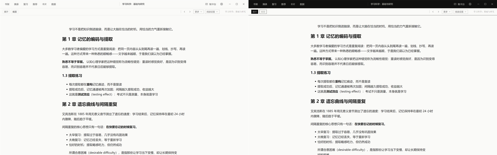
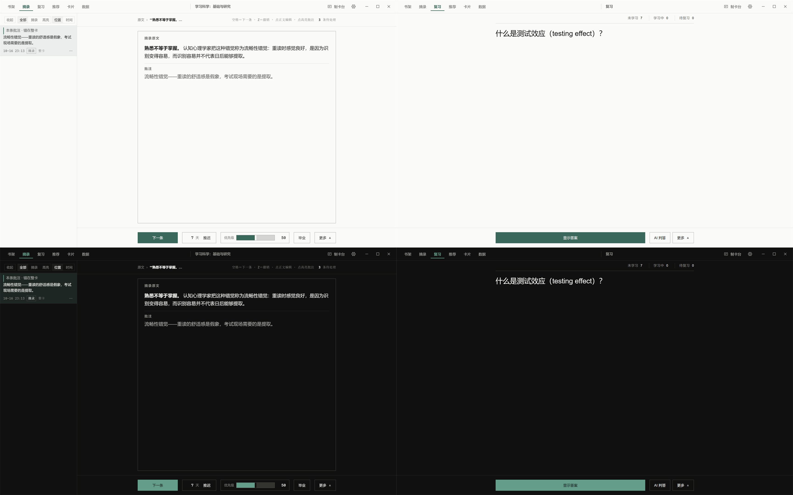
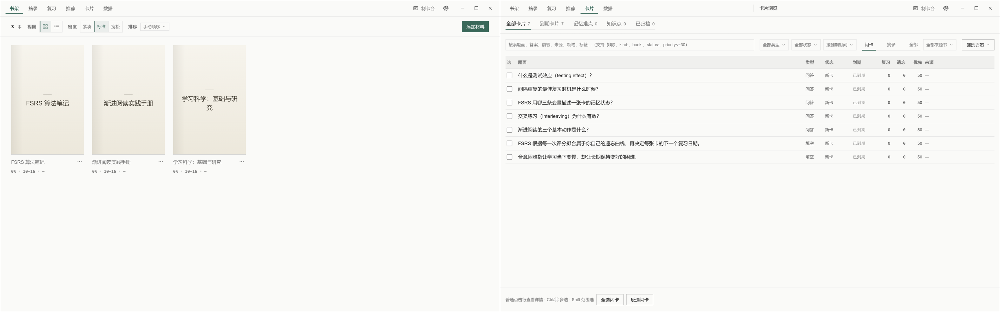
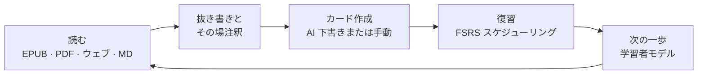

<div align="center">


# Nutation

**ローカルファーストのインクリメンタルリーディング・スタジオ —— 読んで、抜き書きして、記憶する。**

[](./LICENSE)
[](#はじめに)
[](https://www.electronjs.org/)
[](https://react.dev/)
[](https://www.typescriptlang.org/)


[English](./README.md) | [简体中文](./README.zh-CN.md) | 日本語

</div>

---

<div align="center">

<p><sub>閲覧ビュー · ライト / ダークテーマ</sub></p>
</div>

<div align="center">

<p><sub>抜き書きキュー（左）と FSRS 復習（右） · ライト / ダークテーマ</sub></p>
</div>

<div align="center">

<p><sub>本棚（左）とカードブラウザ（右）</sub></p>
</div>

## なぜ「Nutation」なのか

植物が成長するとき、その先端は空中でゆっくりと円を描き、周囲を感じ取ってから、進む方向を選びます。この運動は **回転頭運動（circumnutation）** と呼ばれます。地図も、正解もありません。一株一株の植物が、それぞれ自分のリズムで世界を感じ取り、自分の方向を見つけています。

**Nutation** の名前はここから来ています。

学びもまた、そうあるべきだと私は信じています。必修の科目はなく、唯一の道も、到達すべき標準答案もありません。自分の環境から出発し、自分の好奇心に従い、一周また一周と探りながら、少しずつ育っていく。

円を描くことは迷子になることではなく、方向を探しているのです。ゆっくりなのは遅れていることではなく、根を下ろしているのです。

すべての学び手が、あの幼い苗のように、安心して探検し、回り道を堂々と歩み、最後には自分だけの形に育ちますように。

## 仕組み

Nutation は「読む」と「記憶する」を一つのループでつなげます：



すべてはあなたの PC の上で完結します。AI は任意で、常に下書きのみ——あなたの確認なしに、何もライブラリには入りません。

## 主な機能

| | |
| --- | --- |
| **閲読カーネル —— すべてが本になる** | EPUB・MOBI・AZW3・FB2・CBZ をそのまま開ける。PDF はネイティブ閲覧。Word・TXT・Markdown・HTML はワンクリックで本として取り込み。目次サイドバー、スクロールとページ送りの両モード、複数の紙面外観、そして前回の正確な位置まで進度を復元。 |
| **抜き書きとその場注釈** | 読みながら、選んで残す：範囲選択で抜き書き、その場で注釈、注釈パネルと注釈ナビゲーション。抜き書きは SuperMemo のセマンティクスでスケジューリングされ、没入ビューで一件ずつ処理——いつでも原文の現場へジャンプできます。 |
| **AI カード生成** | テキストを選ぶだけでカード下書き：穴埋め（クローズ）・Q&A・フリップ形式・画像穴埋めの 4 形式。素材タイプはローカルで自動ルーティングされ、全カードが CardLint 品質チェックを通過します。AI は下書きのみ、確認して初めてライブラリ入り。AI サービスがなくても手動カード作成はそのまま使えます。 |
| **FSRS 分散反復復習** | ドリル式の連続復習：四段階評価・自動次カード・ワンクリック取り消し・原文ジャンプして戻る。記憶の弱点は自動検出され、レスキューウィザードが順に対応。FSRS パラメータは設定画面で、あなた自身の復習ログから再学習できます。 |
| **学習者モデルと次の一歩** | 「次へ」パネルが構造化された学習推奨を提示。知識ポイントは 5 段階の習熟度を持ち、すべて監査可能な学習エビデンスから算出されます。学習者メモリはローカルの Markdown ファイルとして層別に管理され、カード生成の文脈となります。 |
| **データ・統計・バックアップ** | ダッシュボードは学習ヒートマップ・完了度・分野分布・評価内訳をカバー。カードブラウザは検索構文と一括操作に対応。手動と自動のバックアップが併存し、データはいつでも持ち出せます。 |

さらに内蔵：**マテリアルマップとナレッジグラフ** · **辞書**（オンライン + ローカル StarDict / DSL / ECDICT）· **ジャーナルと AI インサイト** · **コマンドレジストリ（ショートカット全カスタマイズ可）** · **グローバルショートカットでのクイック記録** · **UDC 分類** · **スキン体系**（スイス・インターナショナル・スタイル基線、ライト / ダーク）。

## 対応フォーマット

| フォーマット | 開き方 |
| --- | --- |
| EPUB · MOBI · AZW3 · FB2 · CBZ | 閲読カーネル（foliate-js）でネイティブ表示、CFI アンカーで位置特定 |
| PDF | 内蔵 PDF 閲覧 |
| Word (.docx) · TXT · Markdown · HTML | ワンクリックで本として取り込み |
| 貼り付けたテキスト | 読める本として合成 |

## プライバシーとローカルファースト

- **アカウント不要** —— 登録なしで、開いたらすぐ使える。
- **テレメトリゼロ** —— 使用データの収集も送信も一切なし。
- **クラウドゼロ** —— ローカルの SQLite データベースとローカルファイルが唯一のデータ源。
- **AI は任意** —— 自分の API キーを持ち込む方式（OpenAI 互換プリセット、ローカル Ollama / LM Studio の自動検出つまり）。キーは OS のストレージでプロバイダ別に暗号化され、まとめてオフにもできます。AI がなくても全コア機能はそのまま動作します。

## 技術スタック

| レイヤー | 採用技術 |
| --- | --- |
| デスクトップシェル | Electron 31 + Vite 6 |
| フロントエンド | React 18 + TypeScript（strict モード） |
| 閲読カーネル | foliate-js（vendor 固定スナップショット）+ 防腐層、CFI アンカー |
| ストレージ | SQLite（better-sqlite3、WAL）、全書き込みをアトミックに永続化 |
| スケジューリング | ts-fsrs（FSRS-6.0）+ fsrs-rs オプティマイザ —— あなたの復習ログから 21 次元の重みを学習 |
| AI ゲートウェイ | OpenAI 互換ストリーミング、14+ プロバイダプリセット、キーは safeStorage で暗号化 |
| レンダリング | markdown-it / react-markdown、KaTeX、Milkdown エディタ |
| パッケージング | electron-builder —— NSIS ウィザード式インストーラ、Windows x64 |

## はじめに

### ダウンロード

[Releases](https://github.com/xiongdy54/Nutation/releases) ページから Windows インストーラを入手できます。ウィザード式でインストール先を選択可能。アンインストールしてもデータは削除されません。

### ソースからビルド

必要要件：[Node.js](https://nodejs.org/) 18 以上と npm。

```bash
git clone https://github.com/xiongdy54/Nutation.git
cd Nutation
npm install        # Electron 向けネイティブ SQLite モジュールを自動でピン留め
npm run dev        # 開発モード（Vite + Electron、ホットリロード）
```

本番ビルドとパッケージング：

```bash
npm run build      # レンダラを dist/ にビルド
npm start          # ビルド済みアプリを起動
npm run dist       # Windows NSIS インストーラを release/ に生成
```

## データの保存場所

すべてのデータは PC の `%APPDATA%\incremental-reading-dev\` に保存されます：`library.db`（ライブラリ・カード・復習ログ）、`dictionary.db`、`learner.db`、そしてバックアップと学習者メモリのファイル。手動・自動バックアップは内蔵され、このフォルダごとコピーすれば完全なバックアップになります。アプリをアンインストールしてもこのフォルダは消えません。

## ロードマップ

- GitHub Releases 経由の自動更新チャネル（electron-updater はすでに組み込み済み）
- Windows x64 以外のプラットフォーム対応
- 任意のクラウド同期 —— ローカルライブラリが常に唯一のデータ源であり続けます

Nutation は活発に開発中です。フィードバックと問題報告を歓迎します。

## コントリビューション

本プロジェクトは現在、単一作者が設計ドキュメント駆動で開発しています。使用感のフィードバック・問題報告・バグの再現手順を歓迎します —— [issue](https://github.com/xiongdy54/Nutation/issues) を立ててください。コードのコントリビューションはプロジェクトのライセンスに従います：

## ライセンス

[GNU Affero General Public License v3.0](./LICENSE)（AGPL-3.0）の下でライセンスされています。

## 謝辞

- [foliate-js](https://github.com/johnfactotum/foliate-js) —— EPUB / MOBI 閲読カーネル
- [ts-fsrs](https://github.com/open-spaced-repetition/ts-fsrs) と [fsrs-rs](https://github.com/open-spaced-repetition/fsrs-rs) —— FSRS スケジューラとオプティマイザ（Open Spaced Repetition）
- [SuperMemo](https://www.supermemo.com/) —— 本プロジェクトの着想源であるインクリメンタルリーディングの方法論
- Electron · React · Vite · better-sqlite3 · pdf.js · KaTeX · Milkdown、そしてそれらを支えるオープンソースコミュニティ
