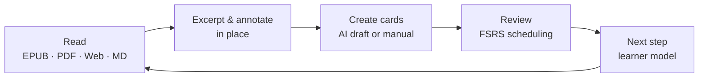

<div align="center">


# Nutation

**A local-first incremental reading studio — read, excerpt, remember.**

[](./LICENSE)
[](#getting-started)
[](https://www.electronjs.org/)
[](https://react.dev/)
[](https://www.typescriptlang.org/)


English | [简体中文](./README.zh-CN.md) | [日本語](./README.ja.md)

</div>

---

<div align="center">

<p><sub>Bookshelf — the whole library on one page</sub></p>
</div>

<div align="center">

<p><sub>FSRS review — card back with the four grade buttons</sub></p>
</div>

<div align="center">

<p><sub>Card dock — manual &amp; AI card creation side by side</sub></p>
</div>

**The card dock** puts manual and AI card creation in one place — docked beside your reading, or as a standalone window summoned by a global shortcut. Paste any text in free mode, or work straight from what you are reading.

**AI card modes.** Select text and Nutation routes it locally by material type — no cloud round-trip needed to decide the form:

| Material type | Default card form |
| --- | --- |
| Concept | Q&amp;A (convertible to flip-card) |
| Formula | Q&amp;A with LaTeX |
| Sequence | sequence continuation |
| Enumeration | cloze |
| Image | image occlusion |
| Literature / poetry | Q&amp;A |
| Vocabulary | four-card set (recognition / recall / listening / sentence cloze) |

Auto mode detects the type with local heuristics and you can always override it. Every draft passes CardLint quality checks and waits for your confirmation before entering the review queue — AI only drafts, you decide.

<div align="center">

<p><sub>Excerpt sidebar — annotations beside the text</sub></p>
</div>

**The excerpt sidebar** keeps every annotation one click away while you read: jump between your notes and the exact source passage, add comments, colors and tags in place — the reading context is never lost.

<div align="center">

<p><sub>Dashboard — every signal computed from your own review logs</sub></p>
</div>

**The dashboard** turns your library into readable signals: a per-day timeline across reading, excerpting, reviewing and card-making; learning heatmap; due forecast; domain distribution; grade breakdown; stability &amp; difficulty distributions; your trained FSRS parameters — nothing invented, all derived from auditable evidence.

## Why "Nutation"?

When a plant grows, its tip slowly draws circles in the air, sensing its surroundings before choosing a direction. This movement is called **circumnutation**. It has no map, and no standard answer. Every plant feels the world at its own rhythm and finds its own way.

**Nutation** is named after this.

I believe learning should be the same: no compulsory subjects, no single path, and no standard answer you are required to reach. Start from your own environment, follow your own curiosity, probe circle by circle, and grow bit by bit.

Circling is not being lost — it is searching for direction. Being slow is not falling behind — it is taking root.

May every learner, like that young seedling, explore without fear, take detours without regret, and finally grow into a shape that belongs only to themselves.

## How it works

Nutation closes the loop between reading and remembering:



Everything runs on your machine. AI is optional and only ever produces drafts — nothing enters your library without your confirmation.

## Features

| | |
| --- | --- |
| **Reading kernel — everything is a book** | EPUB, MOBI, AZW3, FB2, CBZ open directly; PDF has a native reader; Word, TXT, Markdown and HTML are imported as books in one click. TOC sidebar, scroll or paginated modes, multiple paper looks, and progress that returns you to the exact spot where you stopped. |
| **Excerpts & in-place annotation** | Select any passage to excerpt it; annotate in place, browse annotations in a dedicated panel. Excerpts are scheduled with SuperMemo semantics and processed one at a time in an immersive view — jump back to the source context anytime. |
| **Card dock & AI card generation** | One dock for manual and AI card creation — in the main window or as a standalone window with a global shortcut. Select text, get drafts in four forms (cloze, Q&amp;A, flip-card, image occlusion); material type is routed locally and every card passes CardLint quality checks. AI only drafts — you confirm; without any AI service, manual card creation works exactly the same. |
| **FSRS spaced repetition** | Drill-style continuous review: four grades, auto-advance, one-click undo, jump-to-source and back. Memory lapses are detected automatically and walked through with a rescue wizard. FSRS parameters can be retrained in Settings from your own review logs. |
| **Learner model & next step** | A structured "Next" panel recommends what to read and reinforce. Knowledge points carry five mastery levels derived from auditable learning evidence; your learner memory is maintained as local Markdown files that ground card creation. |
| **Data, stats & backup** | A dashboard with a per-day activity timeline, learning heatmap, due forecast, domain distribution and grade breakdown. A card browser with query syntax and batch operations. Manual and automatic backup coexist — your data always leaves with you. |

More built in: **material mind maps & knowledge graph** · **dictionary** (online + local StarDict / DSL / ECDICT) · **journal with AI insights** · **fully remappable shortcuts** · **quick capture** from anywhere with global shortcuts · **UDC domain classification** · **skins** (Swiss International Style baseline, light/dark).

## Supported formats

| Format | How it opens |
| --- | --- |
| EPUB · MOBI · AZW3 · FB2 · CBZ | Native reader kernel (foliate-js), CFI anchors |
| PDF | Built-in PDF reading |
| Word (.docx) · TXT · Markdown · HTML | One-click import as a book |
| Pasted text | Becomes a synthesized, readable book |

## Privacy & local-first

- **Zero account** — no sign-up, it works the moment it opens.
- **Zero telemetry** — nothing is collected, nothing is uploaded.
- **Zero cloud** — a local SQLite database and local files are the only sources of truth.
- **AI optional** — bring your own key (OpenAI-compatible presets, including local Ollama / LM Studio). Keys are encrypted per provider with OS-level storage and can be turned off entirely; without AI, every core feature still works.

## Tech stack

| Layer | Choice |
| --- | --- |
| Desktop shell | Electron 31 + Vite 6 |
| Frontend | React 18 + TypeScript (strict) |
| Reader kernel | foliate-js (vendored snapshot) behind an anti-corruption layer, CFI anchors |
| Storage | SQLite (better-sqlite3, WAL), atomic persist on every write |
| Scheduling | ts-fsrs (FSRS-6.0) + fsrs-rs optimizer — 21-dimension weights trained from your own review logs |
| AI gateway | OpenAI-compatible streaming, 14+ provider presets, keys encrypted with safeStorage |
| Rendering | markdown-it / react-markdown, KaTeX, Milkdown editor |
| Packaging | electron-builder — NSIS wizard installer, Windows x64 |

## Getting started

### Download

Grab the Windows installer from the [Releases](https://github.com/xiongdy54/Nutation/releases) page. The setup wizard lets you pick the installation directory; uninstalling never deletes your data.

### Build from source

Prerequisites: [Node.js](https://nodejs.org/) 18+ and npm.

```bash
git clone https://github.com/xiongdy54/Nutation.git
cd Nutation
npm install        # pins the native SQLite module for Electron automatically
npm run dev        # development mode (Vite + Electron, hot reload)
```

Production build and packaging:

```bash
npm run build      # build the renderer into dist/
npm start          # run the app from the built output
npm run dist       # produce the Windows NSIS installer into release/
```

## Where your data lives

All data stays in `%APPDATA%\incremental-reading-dev\` on your machine: `library.db` (library, cards, review logs), `dictionary.db`, `learner.db`, plus backups and learner memory files. Built-in manual and automatic backups live alongside; copying this folder is a full backup. Uninstalling the app does not delete it.

## Roadmap

- Auto-update channel through GitHub Releases (electron-updater is already wired)
- More platforms beyond Windows x64
- Optional cloud sync — the local library remains the single source of truth

Nutation is under active development. Feedback and issue reports are welcome.

## Contributing

The project is currently developed in a single-author, design-doc-driven workflow. Issue reports, usage feedback and bug reproductions are very welcome — open an [issue](https://github.com/xiongdy54/Nutation/issues). Code contributions land under the project's license:

## License

Licensed under the [PolyForm Noncommercial License 1.0.0](./LICENSE). You are free to use, study, modify and redistribute Nutation for any noncommercial purpose — learning, personal study and hobby projects included. For commercial use, please contact the author.

## Acknowledgments

- [foliate-js](https://github.com/johnfactotum/foliate-js) — the EPUB/MOBI reader kernel
- [ts-fsrs](https://github.com/open-spaced-repetition/ts-fsrs) & [fsrs-rs](https://github.com/open-spaced-repetition/fsrs-rs) — the FSRS scheduler and optimizer (Open Spaced Repetition)
- [SuperMemo](https://www.supermemo.com/) — the incremental reading methodology that inspired this project
- Electron · React · Vite · better-sqlite3 · pdf.js · KaTeX · Milkdown · and the open-source ecosystem around them
