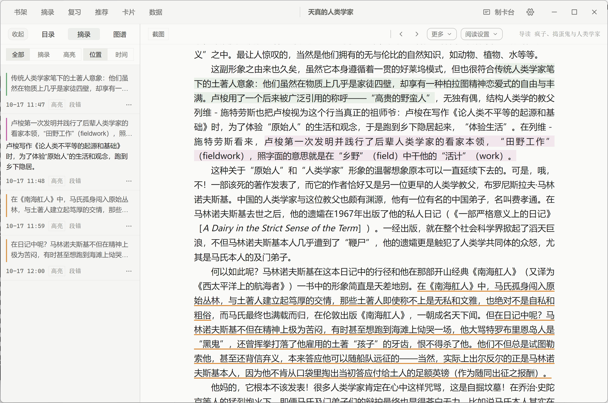
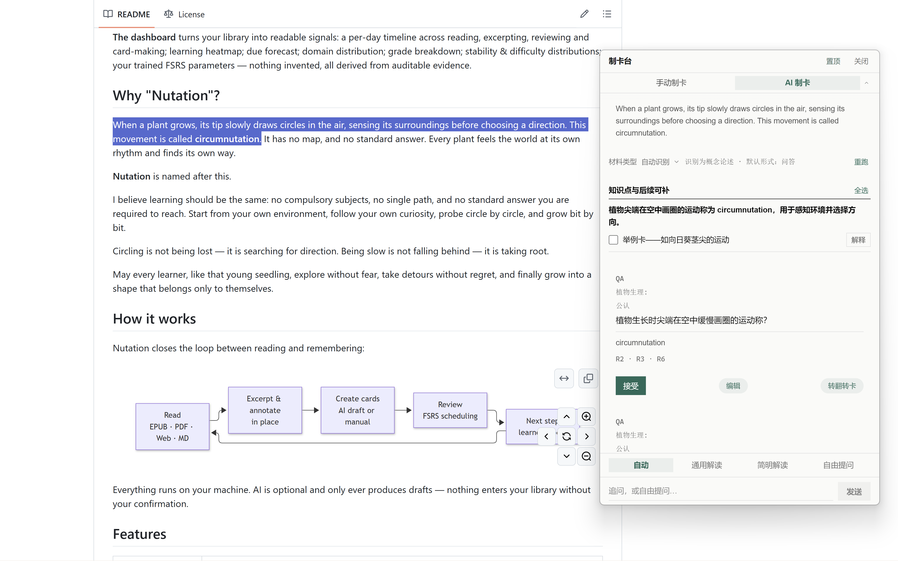
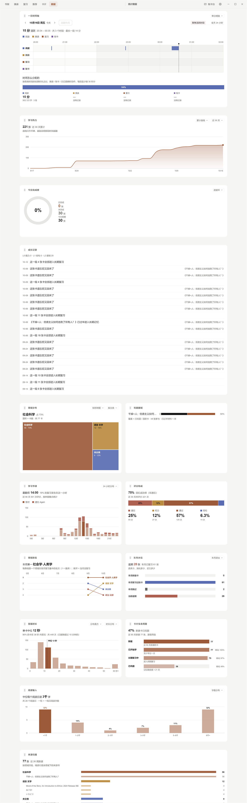
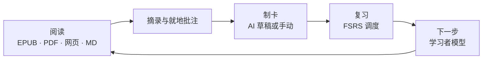

<div align="center">

# 

# Nutation

**本地优先的渐进阅读学习软件 —— 阅读、摘录、记住。**

[](./LICENSE)
[](#快速开始)
[](https://www.electronjs.org/)
[](https://react.dev/)
[](https://www.typescriptlang.org/)


[English](./README.md) | 简体中文 | [日本語](./README.ja.md)

</div>

---

<div align="center">

<p><sub>书架 —— 全部藏书一页呈现</sub></p>
</div>

<div align="center">

<p><sub>结构图谱 —— 先建立整体理解，再去深究细节</sub></p>
</div>

<div align="center">

<p><sub>阅读器 —— 功能丰富但仍然整洁干净，多项功能可自定义</sub></p>
</div>

<div align="center">

<p><sub>间隔重复 —— 使用开源的FSRS算法，在你遗忘之前重温知识点</sub></p>
</div>

<div align="center">

<p><sub>制卡台 —— 手动与 AI 制卡同屏</sub></p>
</div>

**制卡台**把手动制卡与 AI 制卡放进同一个面板——既可以在主窗口侧栏展开，也可以经全局快捷键呼出独立窗口。自由模式下直接粘贴任意文字处理，也可以就着你正在读的内容动手。

**AI 制卡模式。**选中文本，Nutation 在本地按材料类型自动路由——决定卡片形式不需要任何云端往返：

| 材料类型      | 默认卡形                          |
| --------- | ----------------------------- |
| 概念论述      | 问答（可在确认区转翻转问答）                |
| 公式推导      | 问答（LaTeX）                     |
| 流程背诵      | 顺序续写                          |
| 枚举清单      | 挖空                            |
| 图片材料      | 图片挖空                          |
| 文学 / 诗歌背诵 | 问答                            |
| 词汇 / 单词   | 单词四卡（看词识义 / 看义识词 / 听音 / 原句挖空） |

自动模式用本地启发式识别类型，随时可以手动覆盖。每张草稿都要通过 CardLint 规则质检，确认后才进复习队列——AI 只出草稿，是否采纳由你说了算。

<div align="center">

<p><sub>全局制卡台 —— 理解然后记住，随时随地</sub></p>
</div>

<div align="center">

<p><sub>统计仪表盘 —— 你的脚步有迹可循</sub></p>
</div>

**统计仪表盘**把书库变成可读的信号：阅读 / 摘录 / 复习 / 制卡的一日时间轴、学习热力曲线、到期预测、领域分布、评分构成、稳定性与难度分布、你训练出的 FSRS 参数——没有一个是编造的，全部由可审计的证据推导。

## 为什么叫 Nutation？

植物生长时，尖端会在空中缓缓画圈，感受四周，再选择方向。这种运动叫作 **回旋转头运动（circumnutation）**。它没有地图，也没有标准答案。每一株植物都在用自己的节奏感受世界，找到自己的方向。

**Nutation** 由此得名。

学习也该是这样：没有必修的科目，没有唯一的方向，也没有必须抵达的标准答案。从你自己的环境出发，跟着自己的好奇心，一圈一圈地试探，一点一点地生长。

绕圈不是迷路，是在寻找方向。慢不是落后，是在扎根。

愿每一位学习者，都能像那株幼苗一样，放心地探索，坦然地绕路，最终长成只属于自己的形状。

## 它如何工作

Nutation 把「读」与「记住」连成一条闭环：



一切都在你的电脑上完成。AI 是可选的，且永远只出草稿——没有你的确认，任何内容都不会进入你的知识库。

## 核心能力

|                 |                                                                                                                                     |
| --------------- | ----------------------------------------------------------------------------------------------------------------------------------- |
| **阅读内核 · 一切皆书** | EPUB、MOBI、AZW3、FB2、CBZ 直接打开；PDF 原生阅读；Word、TXT、Markdown、HTML 一键导入成书。目录侧栏、滚动与分页双模式、多种纸面外观，进度精确回到上一次的位置。                               |
| **摘录与就地批注**     | 读到哪，划到哪：选区摘录、就地批注、批注栏与注解导航。摘录按 SuperMemo 语义调度，一屏一条沉浸式处理，随时跳回原文现场。                                                                   |
| **制卡台与 AI 制卡**  | 手动与 AI 制卡同属一个制卡台——主窗口侧栏或全局快捷键呼出的独立窗口。选中文本即出草稿，四种卡形（挖空、问答、翻转问答、图片挖空）；材料类型本地自动路由，每张卡经 CardLint 规则质检。AI 只出草稿，确认才入库；没有 AI 服务时，手动制卡照常可用。 |
| **FSRS 间隔重复复习** | 连续刷题式复习：四档评分、自动下一张、一键撤销评分、跳转原文再回现场。记忆难点自动识别，救援向导逐一处理；FSRS 参数可在设置中用你自己的复习记录重新训练。                                                     |
| **学习者模型与下一步推荐** | 「下一步」面板给出结构化学习推荐；知识点掌握分五级，全部来自可审计的学习证据；用户记忆以本地 Markdown 文件分层维护，为制卡提供接地情境。                                                           |
| **数据、统计与备份**    | 统计仪表盘覆盖一日活动时间轴、学习热力、到期预测、领域分布与评分构成；卡片浏览器支持查询语法与批量操作；手动与自动备份并存，数据随时带走。                                                               |

还有更多内置：**材料导图与知识图谱** · **词典**（在线词库 + 本地 StarDict / DSL / ECDICT）· **日记与 AI 洞察** · **命令注册表（快捷键全部可自定义）** · **全局快捷键快速记录** · **UDC 领域分类** · **皮肤体系**（瑞士国际主义风格基线，浅色 / 深色）。

## 支持的格式

| 格式                                   | 打开方式                          |
| ------------------------------------ | ----------------------------- |
| EPUB · MOBI · AZW3 · FB2 · CBZ       | 阅读内核（foliate-js）原生打开，CFI 锚点定位 |
| PDF                                  | 内置 PDF 阅读                     |
| Word (.docx) · TXT · Markdown · HTML | 一键导入成书                        |
| 粘贴的文本                                | 合成为一本可读的书                     |

## 隐私与本地优先

- **零账号** —— 无需注册，打开即用。
- **零遥测** —— 不收集、不上传任何使用数据。
- **零云端** —— 本地 SQLite 数据库与本地文件是唯一数据真源。
- **AI 可选** —— 自带密钥（OpenAI 兼容预设，含本地 Ollama / LM Studio 一键探测）。密钥经系统级存储按服务商加密保存，可整体关闭；关闭后所有核心功能照常可用。


## 快速开始

### 下载

前往 [Releases](https://github.com/xiongdy54/Nutation/releases) 页面获取 Windows 安装包。Nutation 需要 **Windows 10/11 64 位（x64 / ARM64）**——不提供 32 位（ia32）版本（Electron 44 起不再发布 Windows 32 位构建）。向导式安装，可自选安装目录；卸载不会删除你的数据。

### 从源码构建

前置要求：[Node.js](https://nodejs.org/) 18+ 与 npm。

Linux 上 Electron 还需要系统库——postinstall 会启动 Electron 二进制来验证原生 SQLite 模块：

```bash
# Debian / Ubuntu（Ubuntu 24.04 起 libasound2 改名 libasound2t64）
sudo apt-get install -y libgtk-3-0 libnss3 libxss1 libgbm1 libasound2 xvfb
# Fedora / RHEL / Amazon Linux
sudo dnf install -y gtk3 nss libXScrnSaver mesa-libgbm alsa-lib xorg-x11-server-Xvfb
```

若某个步骤只做构建、不运行 Electron（例如 CI 的构建任务），可设置 `NUTATION_SKIP_ABI_VERIFY=1` 跳过 ABI 验证。

```bash
git clone https://github.com/xiongdy54/Nutation.git
cd Nutation
npm install        # 自动为 Electron 钉住原生 SQLite 模块
npm run dev        # 开发模式（Vite + Electron，热重载）
```

生产构建与打包：

```bash
npm run build      # 构建渲染层产物到 dist/
npm start          # 以构建产物运行应用
npm run dist       # 生成 Windows NSIS 安装包到 release/
```

## 数据在哪里

所有数据都保存在你电脑的 `%APPDATA%\incremental-reading-dev\` 目录：`library.db`（书库、卡片、复习日志）、`dictionary.db`、`learner.db`，以及备份与用户记忆文件。应用内置手动与自动备份，整目录复制即为完整备份。卸载软件不会删除该目录。

## 路线图

- 经 GitHub Releases 的自动更新通道（electron-updater 已接入）
- Windows x64 之外的更多平台
- 可选的云同步——本地书库始终是唯一数据真源

Nutation 处于活跃开发中，欢迎反馈与问题报告。

## 许可

本项目以 [GNU Affero 通用公共许可证 v3.0](./LICENSE) 授权。你可以在该许可证条款下使用、研究、修改与分发 Nutation；若将修改后的版本作为网络服务提供，AGPL 要求向用户提供对应源代码。

## 致谢

- [foliate-js](https://github.com/johnfactotum/foliate-js) —— EPUB / MOBI 阅读内核
- [ts-fsrs](https://github.com/open-spaced-repetition/ts-fsrs) 与 [fsrs-rs](https://github.com/open-spaced-repetition/fsrs-rs) —— FSRS 调度器与优化器（Open Spaced Repetition）
- [SuperMemo](https://www.supermemo.com/) —— 本项目所借鉴的渐进阅读方法论
- Electron · React · Vite · better-sqlite3 · pdf.js · KaTeX · Milkdown，以及它们周围的整个开源生态
