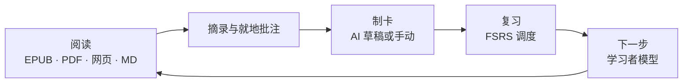

<div align="center">


# Nutation

**本地优先的渐进阅读学习软件 —— 阅读、摘录、记住。**

[](./LICENSE)
[](#快速开始)
[](https://www.electronjs.org/)
[](https://react.dev/)
[](https://www.typescriptlang.org/)


[English](./README.md) | 简体中文 | [日本語](./README.ja.md)

</div>

---

<div align="center">

<p><sub>书架 —— 全部藏书一页呈现</sub></p>
</div>

<div align="center">

<p><sub>FSRS 复习 —— 卡片背面与四档评分按钮</sub></p>
</div>

## 为什么叫 Nutation？

植物生长时，尖端会在空中缓缓画圈，感受四周，再选择方向。这种运动叫作 **回旋转头运动（circumnutation）**。它没有地图，也没有标准答案。每一株植物都在用自己的节奏感受世界，找到自己的方向。

**Nutation** 由此得名。

我相信，学习也该是这样：没有必修的科目，没有唯一的路径，也没有必须抵达的标准答案。从你自己的环境出发，跟着自己的好奇心，一圈一圈地试探，一点一点地生长。

绕圈不是迷路，是在寻找方向。慢不是落后，是在扎根。

愿每一位学习者，都能像那株幼苗一样，放心地探索，坦然地绕路，最终长成只属于自己的形状。

## 它如何工作

Nutation 把「读」与「记住」连成一条闭环：



一切都在你的电脑上完成。AI 是可选的，且永远只出草稿——没有你的确认，任何内容都不会进入你的知识库。

## 核心能力

| | |
| --- | --- |
| **阅读内核 · 一切皆书** | EPUB、MOBI、AZW3、FB2、CBZ 直接打开；PDF 原生阅读；Word、TXT、Markdown、HTML 一键导入成书。目录侧栏、滚动与分页双模式、多种纸面外观，进度精确回到上一次的位置。 |
| **摘录与就地批注** | 读到哪，划到哪：选区摘录、就地批注、批注栏与注解导航。摘录按 SuperMemo 语义调度，一屏一条沉浸式处理，随时跳回原文现场。 |
| **AI 制卡** | 选中文本即出卡片草稿：挖空、问答、翻转问答、图片挖空四种形式，材料类型本地自动路由，每张卡经 CardLint 规则质检。AI 只出草稿，确认才入库；没有 AI 服务时，手动制卡照常可用。 |
| **FSRS 间隔重复复习** | 连续刷题式复习：四档评分、自动下一张、一键撤销评分、跳转原文再回现场。记忆难点自动识别，救援向导逐一处理；FSRS 参数可在设置中用你自己的复习记录重新训练。 |
| **学习者模型与下一步推荐** | 「下一步」面板给出结构化学习推荐；知识点掌握分五级，全部来自可审计的学习证据；用户记忆以本地 Markdown 文件分层维护，为制卡提供接地情境。 |
| **数据、统计与备份** | 统计仪表盘覆盖学习热力、完成度、领域分布与评分构成；卡片浏览器支持查询语法与批量操作；手动与自动备份并存，数据随时带走。 |

还有更多内置：**材料导图与知识图谱** · **词典**（在线词库 + 本地 StarDict / DSL / ECDICT）· **日记与 AI 洞察** · **命令注册表（快捷键全部可自定义）** · **全局快捷键快速记录** · **UDC 领域分类** · **皮肤体系**（瑞士国际主义风格基线，浅色 / 深色）。

## 支持的格式

| 格式 | 打开方式 |
| --- | --- |
| EPUB · MOBI · AZW3 · FB2 · CBZ | 阅读内核（foliate-js）原生打开，CFI 锚点定位 |
| PDF | 内置 PDF 阅读 |
| Word (.docx) · TXT · Markdown · HTML | 一键导入成书 |
| 粘贴的文本 | 合成为一本可读的书 |

## 隐私与本地优先

- **零账号** —— 无需注册，打开即用。
- **零遥测** —— 不收集、不上传任何使用数据。
- **零云端** —— 本地 SQLite 数据库与本地文件是唯一数据真源。
- **AI 可选** —— 自带密钥（OpenAI 兼容预设，含本地 Ollama / LM Studio 一键探测）。密钥经系统级存储按服务商加密保存，可整体关闭；关闭后所有核心功能照常可用。

## 技术栈

| 层 | 选型 |
| --- | --- |
| 桌面壳 | Electron 31 + Vite 6 |
| 前端 | React 18 + TypeScript（严格模式） |
| 阅读内核 | foliate-js（vendor 固定快照）+ 防腐层隔离，CFI 锚点 |
| 存储 | SQLite（better-sqlite3，WAL），每次写入原子落盘 |
| 调度 | ts-fsrs（FSRS-6.0）+ fsrs-rs 优化器——用你自己的复习日志训练 21 维权重 |
| AI 网关 | OpenAI 兼容流式，14+ 服务商预设，密钥经 safeStorage 加密 |
| 渲染 | markdown-it / react-markdown、KaTeX、Milkdown 编辑器 |
| 打包 | electron-builder —— NSIS 向导式安装，Windows x64 |

## 快速开始

### 下载

前往 [Releases](https://github.com/xiongdy54/Nutation/releases) 页面获取 Windows 安装包。向导式安装，可自选安装目录；卸载不会删除你的数据。

### 从源码构建

前置要求：[Node.js](https://nodejs.org/) 18+ 与 npm。

```bash
git clone https://github.com/xiongdy54/Nutation.git
cd Nutation
npm install        # 自动为 Electron 钉住原生 SQLite 模块
npm run dev        # 开发模式（Vite + Electron，热重载）
```

生产构建与打包：

```bash
npm run build      # 构建渲染层产物到 dist/
npm start          # 以构建产物运行应用
npm run dist       # 生成 Windows NSIS 安装包到 release/
```

## 数据在哪里

所有数据都保存在你电脑的 `%APPDATA%\incremental-reading-dev\` 目录：`library.db`（书库、卡片、复习日志）、`dictionary.db`、`learner.db`，以及备份与用户记忆文件。应用内置手动与自动备份，整目录复制即为完整备份。卸载软件不会删除该目录。

## 路线图

- 经 GitHub Releases 的自动更新通道（electron-updater 已接入）
- Windows x64 之外的更多平台
- 可选的云同步——本地书库始终是唯一数据真源

Nutation 处于活跃开发中，欢迎反馈与问题报告。

## 参与

项目目前由单一作者以设计文档驱动的方式开发。使用反馈、问题报告与 Bug 复现都非常欢迎——请提 [issue](https://github.com/xiongdy54/Nutation/issues)。代码贡献按项目许可证进行：

## 许可证

基于 [PolyForm Noncommercial License 1.0.0](./LICENSE) 授权：允许学习、修改、分发与非商业使用；商业使用请联系作者获得授权。

## 致谢

- [foliate-js](https://github.com/johnfactotum/foliate-js) —— EPUB / MOBI 阅读内核
- [ts-fsrs](https://github.com/open-spaced-repetition/ts-fsrs) 与 [fsrs-rs](https://github.com/open-spaced-repetition/fsrs-rs) —— FSRS 调度器与优化器（Open Spaced Repetition）
- [SuperMemo](https://www.supermemo.com/) —— 本项目所借鉴的渐进阅读方法论
- Electron · React · Vite · better-sqlite3 · pdf.js · KaTeX · Milkdown，以及它们周围的整个开源生态
