# 使用教程

> **这份教程是写给第一次用电脑学习软件的人的。**
> 不需要懂电脑，也不用背命令。你只要会三个动作：**点一下、按住拖动、松开**。
>
> 建议这样读：
> 1. 先花 30 秒改一个设置，让按钮显示文字。
> 2. 跟着「先做一遍」走完一次完整学习。
> 3. 其余章节用到时再翻。
>
> 卡住了？直接看最后一节「卡住了怎么办」。

> **先认识 6 个词**
> - **窗口**：屏幕上这个软件的大方框。
> - **按钮**：可以点的小方块，或者带文字的小条。
> - **点一下**：把鼠标箭头移到上面，按一下鼠标左键。
> - **按住拖动**：按住鼠标左键不松手，移动鼠标，再松开。
> - **划选**：在文字上按住左键拖动，让文字变蓝。
> - **右上角**：窗口的右上方。

---

## 开始之前：花 30 秒改一个设置

软件的默认界面为了好看，把一些按钮做成了小图标。第一次用会认不出来。我们先把它改成文字。

### 第 1 步：打开设置

看窗口的**右上角**，有一个**齿轮图标**。点它。

### 第 2 步：把选中文字后的按钮改成文字

1. 在设置窗口的**左边**，点「阅读」。
2. 往下找到「选区与批注」。
3. 找到「选区浮条按钮样式」，点右边的「文字」。

改完后，你在书里选中文字时，旁边的小条会直接写出「批注」「制卡」这些字，不用猜图标。

### 第 3 步：关掉设置

点设置窗口右上角的关闭按钮，或者按 `Esc`。

> 这一步只需要做一次，以后软件会记住。

---

## 先做一遍：完成你的第一次学习

这一节只做一件事：**把一段文字变成一张卡片，再复习一次。**

中间遇到不认识的词，先跳过。做完就懂了。

> 如果软件还没打开：双击桌面上的软件图标。

### 第 1 步：回到书架

看窗口**最上面一排字**，点最左边的「书架」。

你会看到：一页书的封面。这就是你的书架。

### 第 2 步：新建一本练习书

1. 点书架**右上角**蓝色的「添加材料」。
2. 在弹出的两项里，点「粘贴材料」。
3. 在「书名」框里输入：`我的第一次练习`
4. 在下面的大白框里，输入或粘贴下面这段话：

> 渐进阅读的意思是：读一点，挑出重要的句子，做成卡片，按软件的安排复习。这样比从头读到尾更容易记住。

5. 点右下角的「保存到书架」。

你会看到：书架上多了一本《我的第一次练习》。

### 第 3 步：打开这本书

把鼠标移到《我的第一次练习》的封面上，点一下。

你会看到：正文出现在屏幕中间。

> 如果左边没有出现侧栏，点屏幕**左上角**的「展开」。侧栏里会放你的高亮、摘录和批注。

### 第 4 步：划选一句话

把鼠标移到正文的「渐进阅读」前面。

**按住鼠标左键不要松手**，向右拖到「复习。」后面，再松手。

你会看到：这句话变蓝，旁边弹出一个小条。

> 用触控板也一样：按住触控板不放，拖动，再松开。

### 第 5 步：把这句话变成卡片

在小条上点「制卡」。

你会看到：屏幕右边打开「制卡台」，正面已经带上了你选中的那句话。

1. 在「正面」框里，把句子改成问题：`渐进阅读的四个步骤是什么？`
2. 在「背面」框里写答案：`读一点、摘出重点、做成卡片、按安排复习。`
3. 点「创建卡片」。

> 正面会自动带上你选中的原文。把它改成问题，卡片才更好复习。

### 第 6 步：复习这张卡

1. 点最上面一排的「复习」。
2. 看卡片正面的问题，在心里回答。
3. 点「显示答案」。
4. 对照答案，按真实情况点一个：

| 你刚才的情况 | 点这个按钮 |
| --- | --- |
| 完全忘了 | 重来 |
| 想起来了，但很费劲 | 困难 |
| 正常想起来了 | 良好 |
| 太简单了，秒懂 | 简单 |

点完会自动出现下一张。没有下一张时，页面会写「今日到期卡片已清空」。

> 如果这里说今天没有卡，说明这张卡已经排到以后了。明天再点「复习」即可。

### 第 7 步：看一眼「数据」

点最上面一排的「数据」。

这里能看到今天复习了多少、连续学了几天。不用操作，看就好。

**恭喜，你已经完成了一次完整的学习循环。**

---

## 软件地图：每个按钮是做什么的

窗口最上面一排，从左到右：

| 你看到的名字 | 在哪里 | 用来做什么 |
| --- | --- | --- |
| 书架 | 左上 | 放你的书和材料。点这里回到书架。 |
| 复习 | 上方 | 复习今天到期的卡片。 |
| 卡片 | 上方 | 查看、搜索、修改你做过的所有卡片。 |
| 数据 | 上方 | 看学习统计。 |
| 制卡台 | 右上 | 手动做卡片，或让 AI 帮你做。也可以按 `Ctrl+K`。 |
| 齿轮图标 | 最右上 | 设置：改字体、备份、快捷键等。 |
| 添加材料 | 书架页右上 | 只在书架页出现。可以粘贴文字或导入文件。 |

### 阅读页长什么样

- **中间**是正文。
- **左边**是侧栏，放你的高亮、摘录和批注。
- 侧栏收起时，点左上角的「展开」。
- **选中文字**后，文字旁边会出现一个小条，里面有颜色和动作按钮。

### 书架页能做什么

- 点书的封面或书名：打开这本书。
- 点书名右边的「⋯」：重命名、改语言、删除等。
- 点右上角「添加材料」：粘贴文字，或导入 PDF、EPUB、Word、TXT、Markdown、HTML 等文件。

### 删除一本书

1. 把鼠标移到书名那一行。
2. 点右边的「⋯」。
3. 点「删除…」。
4. 点「确认删除」。

书删掉后，**摘录和卡片还在**，不会跟着消失。

---

## 阅读时最常用的四件事

### 第一件：涂色（高亮）

1. 划选一句话。
2. 点小条左边任意一个**彩色小圆点**。

这句话就涂上颜色了。

> 想取消：点一下这段彩色文字，在弹出的小窗里点「删除高亮」。

### 第二件：摘录（把重要的句子收进学习队列）

1. 划选一句话。
2. 点小条最右边写着「高亮」的按钮（旁边有一个小三角）。
3. 在展开的选项里，点「摘录」。按钮会亮起来。
4. 再点一个彩色小圆点。

你会看到：左边侧栏多了一条「摘录」。

**高亮和摘录的区别：**

- **高亮**只是涂色，方便回看。
- **摘录**会把这句话单独收进学习队列，之后可以制卡、复习，也可以对摘录再摘录。

> 摘录可以一层一层往下分：在摘录卡里再划选、再摘录，形成你的理解层次。

### 第三件：批注（写下你的想法）

1. 划选一句话。
2. 点小条上的「批注」。
3. 在出现的小框里写你的想法。
4. 点一个彩色小圆点保存。

批注会出现在左边侧栏。点一下批注，可以继续修改。

### 第四件：制卡（把一句话变成卡片）

1. 划选一句话。
2. 点小条上的「制卡」。
3. 在右边的制卡台里写正面和背面。
4. 点「创建卡片」。

也可以先摘录，之后在左边侧栏点开那条摘录，再点底部的「就此制卡」。

### 还有这些按钮

小条上还有「AI 制卡」「AI 解释」「查词」。

- **AI 制卡 / AI 解释**：需要先在「设置 → AI 服务」里配置 AI 服务。不配置也能用所有核心功能。
- **查词**：需要先在「设置 → 词典与查词」里安装词典。

第一次用可以先不管这三个。

---

## 卡片、制卡台和复习

### 四种卡片

| 卡片类型 | 长什么样 | 什么时候用 |
| --- | --- | --- |
| 问答题 | 正面问题，背面答案 | 最常用。记概念、记事实。 |
| 翻转问答 | 一次做两张，互相反过来问 | 正反两个方向都要记。 |
| 填空题 | 一句话里挖掉一个词 | 记定义、记单词、记句子。 |
| 图片挖空 | 在图片上盖住一块，让你回想 | 记地图、解剖图、图表。 |

### 做一张问答题

1. 点右上角的「制卡台」，或按 `Ctrl+K`。
2. 在「正面」框写问题。建议带上领域，例如：`统计: 中位数是什么？`
3. 在「背面」框写答案，尽量短。
4. 点「创建卡片」。

### 做一张填空题

1. 在制卡台顶部点「填空题」。
2. 在「挖空文本」框里写一句话，把要考的词用两个星号包起来。

例如：

`渐进阅读的四个步骤是 **读一点、摘出重点、做成卡片、按安排复习**。`

软件会自动把两个星号里的内容变成填空。

### 做一张图片挖空卡

这个需要先在阅读器里选中一张图片。选中后会出现「图片挖空」入口，再在图片上拖出要遮住的区域。

第一次用可以先跳过，等遇到需要记图的材料再用。

### 复习：诚实评分

复习不是考试。它的作用是：在你快要忘记的时候，把卡片再送到你面前。

- 觉得难，就点「困难」或「重来」。算法会更早再给你看。
- 觉得很轻松，才点「简单」。
- **不要装懂。** 装懂只会让遗忘钻空子。

每天复习完，点「数据」看一眼进度即可。

### 「卡片」页是什么

点最上面一排的「卡片」，可以看到你做过的所有卡片。

- 可以搜索。
- 可以修改正面、背面。
- 可以删除不想要的卡片。

---

## 让文字更好看：Markdown（只学 4 个就够）

很多编辑框下面有一排按钮。**先选中文字，再点按钮**，格式就加好了。

你不需要背符号。下面这些符号只是让你知道按钮在做什么。

### 最常用的 4 个

| 想要 | 输入这个 | 会变成 |
| --- | --- | --- |
| 加粗 | `**加粗**` | **加粗** |
| 斜体 | `*斜体*` | *斜体* |
| 高亮 | `==高亮==` | ==高亮== |
| 列表 | `- 第一项` | 前面出现圆点 |

### 标题

在文字最前面加 `#` 和一个空格：

| 输入 | 效果 |
| --- | --- |
| `# 大标题` | 最大的标题 |
| `## 中标题` | 中等的标题 |
| `### 小标题` | 小标题 |

编辑器工具条上的「H」按钮可以帮你选标题级别。

### 换行

- 按一次 `Enter`：换到下一行。
- 按两次 `Enter`：空一行，分成两段。

### 撤销

按 `Ctrl+Z`。点错了就撤销，不会坏。

### 链接和表格（进阶）

链接：`[显示的文字](网址)`

例如：`[回到开头](#使用教程)`

表格：

```text
| 水果 | 价格 |
| --- | --- |
| 苹果 | 5 元 |
| 桃子 | 6 元 |
```

### 工具条不见了怎么办

点右上角齿轮 → 左边「阅读」→ 找到「摘录卡编辑器」→ 勾选「编辑器富文本工具栏」里的「编辑时显示」。

### 批注框里也能写

批注框没有工具条，但可以写上面这些符号。如果写图表，框下方会出现预览。保存后，批注会按格式显示。

---

## 画图：写几行字，自动变成图

这种画图方法叫 **Mermaid**。你不用画板，也不用对齐，只要写几行文字。

### 最快的方法：用「插入图表」按钮

1. 打开一个带工具条的编辑框。比如卡片的背面。
2. 点工具条上的「插入图表」按钮（图标是两个小方块连在一起）。
3. 框里会出现三行字：

```text
flowchart TD
    A[开始] --> B[进行中]
    B --> C[完成]
```

4. 把「开始」「进行中」「完成」换成你自己的词。
5. 退出编辑（点编辑框外面、按 `Esc`，或点「保存」）。图就会显示出来。

上面这三行画出来是这样：

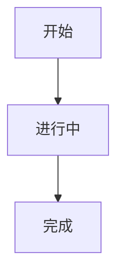

### 只看三件事

- 第一行 `flowchart TD`：表示「从上到下画一张流程图」。`TD` 改成 `LR` 就是从左到右。
- `A[开始] --> B[进行中]`：表示从 A 指向 B。方括号里是框里的文字。
- 想加一步，就再加一行箭头。

### 新手只要记住一条

**只改方括号里的文字，不要改方括号、箭头和第一行。**

### 写错了怎么办

如果图没有出现，而是显示成代码，还出现红字「图表语法有误」，按顺序检查：

1. 第一行是不是 `flowchart TD`？
2. 每一行箭头是不是完整的 `-->`？
3. 文字里如果有括号、引号、冒号，把整段文字用双引号包起来。

例如：

```text
flowchart TD
    A["带(括号)的文字"] --> B[正常文字]
```

最省事的办法：删掉这个图表块，重新点「插入图表」按钮，再改文字。

### 图太宽怎么办

图会按编辑框的宽度缩小。太宽时可以在图表区域左右滚动。把框里的文字改短，图也会变窄。

### 哪些地方可以画图

- 卡片的正面、背面
- 摘录
- 粘贴材料
- 批注（编辑时预览，保存后显示）
- 其他带工具条的编辑框

> 新手只需要会流程图。下面这些图型，等你在卡片里想表达某种关系时，再回来查。

---

## 图型字典：33 种图，用到再查

> **先记住一句话：你只需要会流程图。**
>
> 下面每种图都给两段：上面是**可以照抄的文字**，下面是**它画出来的样子**。
> 只改引号或方括号里的文字，不要改第一行和箭头。

### 怎么选图

| 你想表达 | 用这种图 | 编号 |
| --- | --- | --- |
| 先做什么、后做什么、在哪里分叉 | 流程图 | 1 |
| 谁先说、谁后说、谁回应 | 时序图 | 2 |
| 一个东西有几种状态，怎么切换 | 状态图 | 3 |
| 一件事的先后大事 | 时间线 | 4 |
| 一段时间内的安排和进度 | 甘特图 | 5 |
| 想法从中心向外发散 | 思维导图 | 14 |
| 事物之间是什么关系 | 类图 / 实体关系图 | 15 / 16 |
| 占多大比例 | 饼图 | 24 |
| 数字的多少和趋势 | 柱状 / 折线图 | 25 |
| 按两个维度分类 | 象限图 | 26 |
| 追查一件事的原因 | 鱼骨图 | 13 |
| 流量分别去了哪里 | 桑基图 | 28 |
| 代码的提交和分支 | Git 图 | 31 |

### 一、流程与计划（2–13）

#### 2. 时序图（sequenceDiagram）——谁先说，谁后说

适合表示：两个或几个对象之间，按时间顺序来回交流。

```text
sequenceDiagram
    participant 我
    participant 软件
    我->>软件: 打开一本书
    软件-->>我: 显示正文
    我->>软件: 划选一段文字
    软件-->>我: 弹出摘录菜单
```

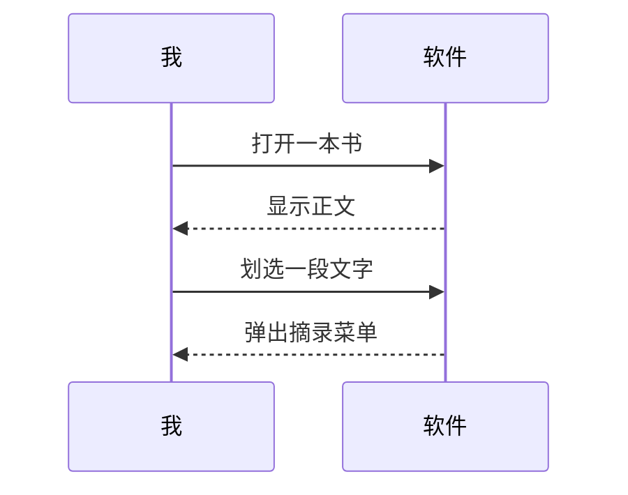

小提示：`->>` 是实线箭头，`-->>` 是虚线箭头，冒号后面是说的话。

#### 3. 状态图（stateDiagram-v2）——一个东西的几种状态

适合表示：一个东西会在哪几个状态之间切换。

```text
stateDiagram-v2
    [*] --> idle
    idle --> reading: 打开书
    reading --> reviewing: 开始复习
    reviewing --> reading: 继续读
    reading --> [*]: 读完
```

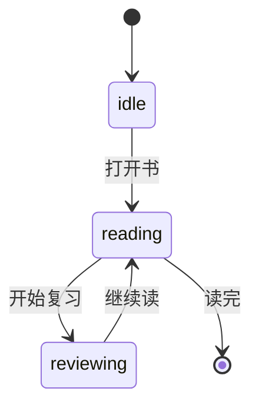

小提示：`[*]` 是开始或结束的圆点，`状态 --> 状态: 原因`。

#### 4. 时间线（timeline）——大事记

适合表示：按时间顺序发生的事。

```text
timeline
    title 一个下午
    14点 : 打开书架
    15点 : 读完一章
         : 做了三张卡
    16点 : 开始复习
```

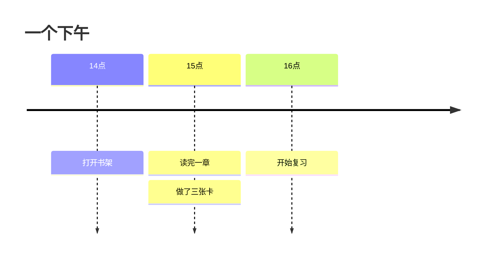

小提示：同一个时间点的多件事，后面几行只写 `: 事情`。

#### 5. 甘特图（gantt）——排计划、看进度

适合表示：一段时间内的任务安排。

```text
gantt
    title 学习计划
    dateFormat YYYY-MM-DD
    section 第一周
        读第一章 :a1, 2026-01-05, 3d
        复习卡片 :after a1, 2d
    section 第二周
        读第二章 :2026-01-12, 4d
```

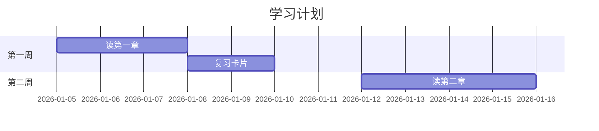

小提示：`dateFormat` 固定写 `YYYY-MM-DD`；`after 编号` 表示接着上一个任务。

#### 6. 用户旅程图（journey）——一件事的体验过程

适合表示：一个人做一件事时，每一步的感受。

```text
journey
    title 我的一天
    section 上午
      读书: 5: 我
      做摘录: 4: 我
    section 晚上
      复习卡片: 3: 我
```

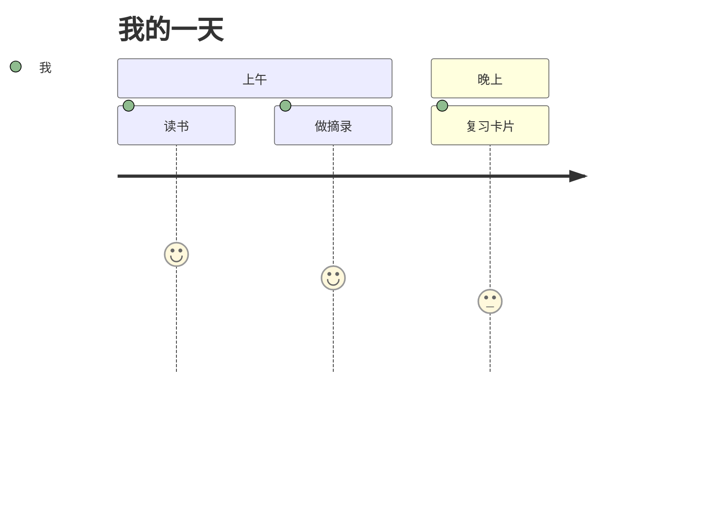

小提示：`做某事: 分数(0-10): 参与者`，分数越高，线越高。

#### 7. 看板（kanban）——任务分栏

适合表示：待办、进行中、已完成。

```text
kanban
  todo[待办]
    t1[读第一章]
  doing[进行中]
    t2[制作闪卡]
  done[完成]
    t3[安装软件]
```

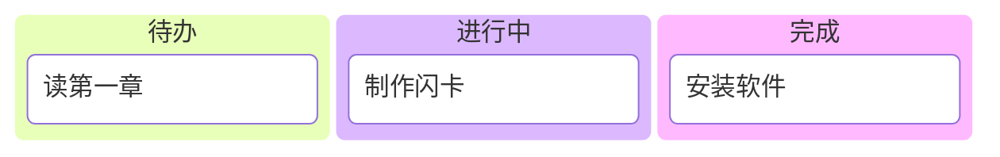

#### 8. 泳道图（swimlane）——按角色分道走流程

适合表示：不同的人或部门各自做什么。

```text
swimlane-beta LR
  subgraph customer[顾客]
    pick[挑商品]
    pay[付款]
  end
  subgraph shop[商家]
    ship[发货]
  end
  pick --> pay
  pay --> ship
```

```mermaid
swimlane-beta LR
  subgraph customer[顾客]
    pick[挑商品]
    pay[付款]
  end
  subgraph shop[商家]
    ship[发货]
  end
  pick --> pay
  pay --> ship
```

#### 9. 方块图（block）——版块布局

适合表示：一页内容分成几块，每块占多宽。

```text
block
  columns 3
  r["读书"] :3
  e["摘录"]
  c["制卡"]
  v["复习"] :3
```

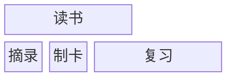

小提示：`columns 3` 是三列，`:3` 表示横跨三列。

#### 10. 事件建模（eventmodeling）——界面→命令→事件

适合表示：用户点一下之后，系统内部发生了什么。

```text
eventmodeling
tf 01 ui CartUI
tf 02 cmd AddItem
tf 03 evt ItemAdded
```

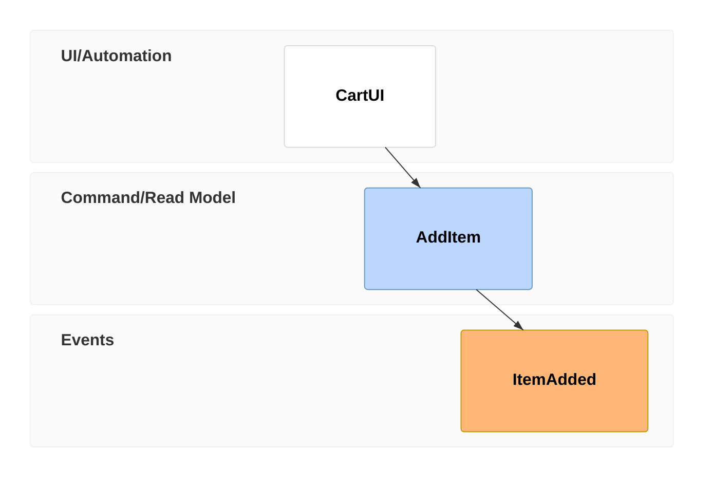

#### 11. 智能体流程（agentflow）——AI 工作流

适合表示：一个 AI 助手先做什么、再做什么。

```text
agentflow-beta TB
  flow tutor["学习助手"]
    ask["提问"]@{ shape: input }
    think["检索笔记"]@{ shape: task }
    answer["给出回答"]@{ shape: task }
    ok["满意？"]@{ shape: decision }
    ask --> think --> answer --> ok
  end
```

```mermaid
agentflow-beta TB
  flow tutor["学习助手"]
    ask["提问"]@{ shape: input }
    think["检索笔记"]@{ shape: task }
    answer["给出回答"]@{ shape: task }
    ok["满意？"]@{ shape: decision }
    ask --> think --> answer --> ok
  end
```

#### 12. Cynefin 图——判断问题属于哪类

适合表示：一个问题应该按哪种方式处理。

```text
cynefin-beta
  title 这个问题属于哪一类
  clear
    "重启就能解决"
  complicated
    "需要专家分析"
  complex
    "先实验再总结"
  chaotic
    "立刻救火"
  confusion
    "还没想清楚"
```

```mermaid
cynefin-beta
  title 这个问题属于哪一类
  clear
    "重启就能解决"
  complicated
    "需要专家分析"
  complex
    "先实验再总结"
  chaotic
    "立刻救火"
  confusion
    "还没想清楚"
```

#### 13. 鱼骨图（ishikawa）——追查原因

适合表示：一个问题可能由哪些原因造成。

```text
ishikawa-beta
    照片模糊
    相机
        对焦不准
        快门太慢
    手
        拿不稳
    环境
        光线太暗
```

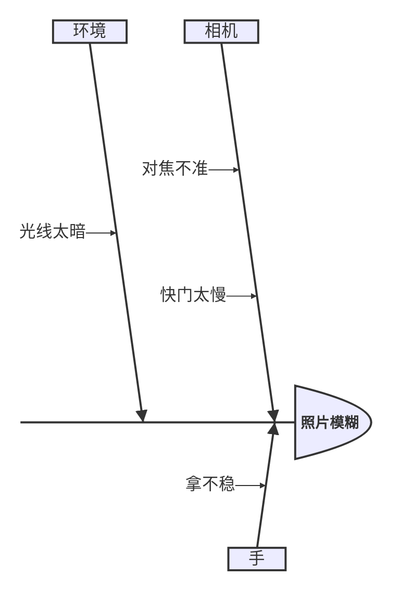

小提示：第一行写「问题」，后面每个大类是一根大骨，缩进的是小骨。

### 二、关系与结构（14–23）

#### 14. 思维导图（mindmap）——想法从中心发散

适合表示：一个主题下面有哪些分支。

```text
mindmap
  root((学习))
    输入
      读书
      看视频
    加工
      摘录
      制卡
    巩固
      复习
```

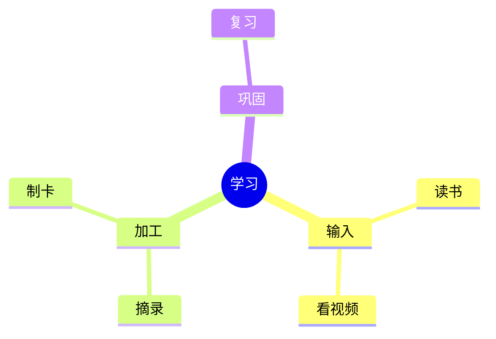

小提示：靠**缩进**表示层级，`root((文字))` 是中间的圆。

#### 15. 类图（classDiagram）——有哪几类东西、什么关系

适合表示：概念之间谁包含谁、谁继承谁。

```text
classDiagram
    class Card {
        +String front
        +String back
        +review()
    }
    class ExtractCard
    class VocabCard
    Card <|-- ExtractCard
    Card <|-- VocabCard
```

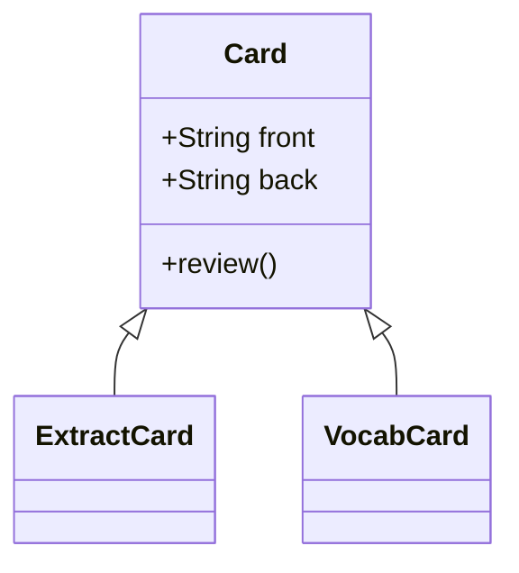

小提示：`<|--` 表示「继承自」。

#### 16. 实体关系图（erDiagram）——事物之间怎么关联

适合表示：书、摘录、卡片之间的一对多关系。

```text
erDiagram
    book ||--o{ extract : 生成摘录
    extract ||--o{ card : 制成卡片
    book ||--o{ card : 拥有
```

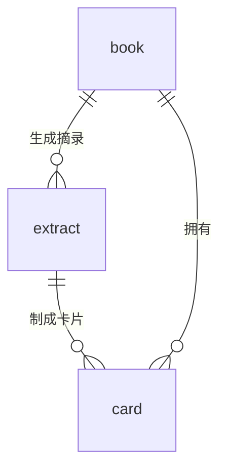

小提示：`||--o{` 读作「一对多」。

#### 17. 需求图（requirementDiagram）——需求与实现对应

适合表示：一条需求由哪个部分来满足。

```text
requirementDiagram
    requirement remember_words {
        id: 1
        text: "每天复习新学的单词"
        risk: high
        verifymethod: test
    }
    element daily_review {
        type: "日常任务"
    }
    daily_review - satisfies -> remember_words
```

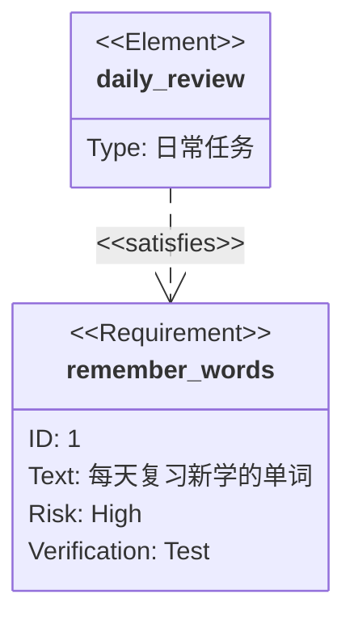

#### 18. C4 架构图（C4Context）——系统与人的关系

适合表示：谁在使用系统，系统由什么组成。

```text
C4Context
    title 学习系统全貌
    Person(learner, "学习者", "想记住知识的人")
    System(app, "本软件", "渐进阅读学习工具")
    Rel(learner, app, "每天使用")
```

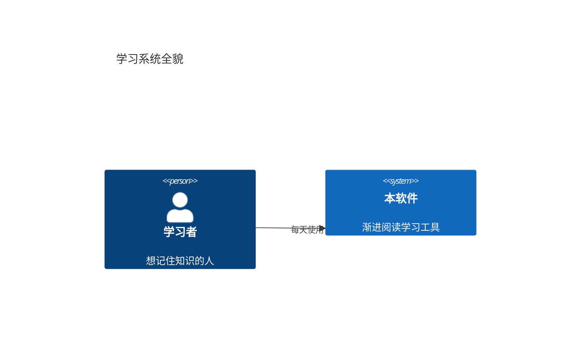

#### 19. 架构图（architecture）——服务怎么连

适合表示：几个服务或模块之间的连接。

```text
architecture-beta
    group learn(cloud)[学习系统]
    service reader(database)[阅读器] in learn
    service engine(server)[复习引擎] in learn
    reader:L -- R:engine
```


#### 20. 数据包图（packet）——二进制位段

适合表示：一段数据分成哪几段，每段占多少位。

```text
packet
0-15: "源端口"
16-31: "目标端口"
32-47: "包长度"
48-63: "校验和"
```

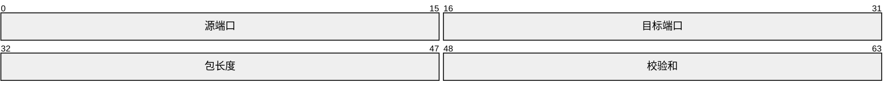

#### 21. 韦恩图（venn）——集合之交

适合表示：几个概念重叠的部分。

```text
venn-beta
  title 什么是好产品
  set Useful
  set Usable
  set Beautiful
  union Useful,Usable["好用"]
  union Useful,Beautiful["有价值"]
  union Usable,Beautiful["好看"]
  union Useful,Usable,Beautiful["完美"]
```

```mermaid
venn-beta
  title 什么是好产品
  set Useful
  set Usable
  set Beautiful
  union Useful,Usable["好用"]
  union Useful,Beautiful["有价值"]
  union Usable,Beautiful["好看"]
  union Useful,Usable,Beautiful["完美"]
```

#### 22. 树视图（treeView）——目录树

适合表示：文件夹和文件的结构。

```text
treeView-beta
├── 我的书架/
│   ├── 使用教程.md
│   └── 英语书.md
└── 我的卡片/
    └── 单词卡.md
```

```mermaid
treeView-beta
├── 我的书架/
│   ├── 使用教程.md
│   └── 英语书.md
└── 我的卡片/
    └── 单词卡.md
```

#### 23. 用例图（usecase）——谁能用系统做什么

适合表示：用户可以使用哪些功能。

```text
usecase-beta
direction LR
actor Student("学生")
systemBoundary "学习系统"
  Read("阅读材料")
  Review("复习卡片")
end
Student --> Read
Student --> Review
```

```mermaid
usecase-beta
direction LR
actor Student("学生")
systemBoundary "学习系统"
  Read("阅读材料")
  Review("复习卡片")
end
Student --> Read
Student --> Review
```

### 三、数据与比较（24–30）

#### 24. 饼图（pie）——比例一望即知

适合表示：各部分占整体的多少。

```text
pie showData
    title 时间都去哪了
    "阅读" : 40
    "复习" : 35
    "制卡" : 25
```

```mermaid
pie showData
    title 时间都去哪了
    "阅读" : 40
    "复习" : 35
    "制卡" : 25
```

小提示：`"名称" : 数值`，`showData` 会把数值标在图上。

#### 25. 柱状/折线图（xychart）——数字趋势

适合表示：一周、一个月的数据变化。

```text
xychart
    title "每周复习量"
    x-axis ["一", "二", "三", "四", "五", "六", "日"]
    y-axis "卡片数" 0 --> 100
    bar [20, 35, 50, 40, 60, 75, 55]
    line [20, 35, 50, 40, 60, 75, 55]
```

```mermaid
xychart
    title "每周复习量"
    x-axis ["一", "二", "三", "四", "五", "六", "日"]
    y-axis "卡片数" 0 --> 100
    bar [20, 35, 50, 40, 60, 75, 55]
    line [20, 35, 50, 40, 60, 75, 55]
```

小提示：`bar` 是柱子，`line` 是线，可以只留一个。

#### 26. 象限图（quadrantChart）——按两个维度分类

适合表示：事情按重要和紧急分成四类。

```text
quadrantChart
    title 怎么安排这些事
    x-axis 不紧急 --> 紧急
    y-axis 不重要 --> 重要
    quadrant-1 马上做
    quadrant-2 计划做
    quadrant-3 少做点
    quadrant-4 委托做
    写报告: [0.75, 0.8]
    回消息: [0.8, 0.3]
    学外语: [0.3, 0.85]
```

```mermaid
quadrantChart
    title 怎么安排这些事
    x-axis 不紧急 --> 紧急
    y-axis 不重要 --> 重要
    quadrant-1 马上做
    quadrant-2 计划做
    quadrant-3 少做点
    quadrant-4 委托做
    写报告: [0.75, 0.8]
    回消息: [0.8, 0.3]
    学外语: [0.3, 0.85]
```

小提示：点的位置写成 `[横向0-1, 纵向0-1]`，右上是第 1 象限。

#### 27. 雷达图（radar）——多维度对比

适合表示：一个人或一个方案在多个维度上的强弱。

```text
radar-beta
  axis a["听力"], b["口语"], c["阅读"], d["写作"], e["词汇"], f["语法"]
  curve me["我"]{80, 65, 90, 70, 85, 75}
  max 100
  min 0
```

```mermaid
radar-beta
  axis a["听力"], b["口语"], c["阅读"], d["写作"], e["词汇"], f["语法"]
  curve me["我"]{80, 65, 90, 70, 85, 75}
  max 100
  min 0
```

#### 28. 桑基图（sankey）——流量去向

适合表示：时间、金钱、注意力分别流向了哪里。

```text
sankey
学习时间,读书,120
学习时间,查词,30
复习时间,复习卡片,90
复习时间,补漏,20
```

```mermaid
sankey
学习时间,读书,120
学习时间,查词,30
复习时间,复习卡片,90
复习时间,补漏,20
```

小提示：每行写 `来源,去向,数量`，用英文逗号。

#### 29. 矩形树图（treemap）——按面积看占比

适合表示：大块里再分小块，面积代表数量。

```text
treemap-beta
"学习时间"
    "读书": 60
    "查词": 10
"复习时间"
    "卡片": 30
```

```mermaid
treemap-beta
"学习时间"
    "读书": 60
    "查词": 10
"复习时间"
    "卡片": 30
```

#### 30. 沃德利地图（wardley）——战略演进图

适合表示：一个产品由哪些部分组成，各部分成熟到什么程度。

```text
wardley-beta
title "奶茶店价值链"

anchor Customer [0.95, 0.63]
component tea [0.79, 0.61]
component leaf [0.63, 0.81]
component water [0.52, 0.80]
component kettle [0.43, 0.35]

Customer -> tea
tea -> leaf
tea -> water
water -> kettle

evolve kettle 0.62
```

```mermaid
wardley-beta
title "奶茶店价值链"

anchor Customer [0.95, 0.63]
component tea [0.79, 0.61]
component leaf [0.63, 0.81]
component water [0.52, 0.80]
component kettle [0.43, 0.35]

Customer -> tea
tea -> leaf
tea -> water
water -> kettle

evolve kettle 0.62
```

小提示：坐标 `[横向, 纵向]` 都是 0 到 1，`evolve` 表示某个部分正在向右演化。

### 四、版本与其他（31–33）

#### 31. Git 图（gitGraph）——提交和分支

适合表示：代码或文件的版本变化。不写代码也可以用它表示「改了几版」。

```text
gitGraph
    commit id: "初版"
    branch dev
    commit id: "加复习功能"
    checkout main
    merge dev
    commit id: "发布"
```

```mermaid
gitGraph
    commit id: "初版"
    branch dev
    commit id: "加复习功能"
    checkout main
    merge dev
    commit id: "发布"
```

#### 32. 信息卡（info）——显示图表引擎的版本

这是一个很小的示例图。平时几乎用不到。

```text
info
```

```mermaid
info
```

#### 33. 铁路图（railroad）——语法规则可视化

适合表示：一条规则可以怎么组合。平时几乎用不到。

```text
railroad-ebnf-beta
title "数字的定义"
digit = "0" | "1" | "2" | "3" ;
```

```mermaid
railroad-ebnf-beta
title "数字的定义"
digit = "0" | "1" | "2" | "3" ;
```

---

## 数据安全：你的东西只在你的电脑上

### 不需要账号

这款软件不需要注册、不需要登录。书、摘录、卡片都存在这台电脑上。

### 什么时候会联网

- **读书、摘录、制卡、复习**：不需要网络。
- **软件更新检查**：会联网。
- **AI 功能**：需要联网，而且要你自己在设置里配置服务。
- **在线词典发音**：需要联网，而且要在设置里选择在线发音。

不用这些功能时，核心学习流程可以完全离线。

### 备份：给数据买保险

1. 点右上角齿轮。
2. 点左边的「备份与恢复」。
3. 点「立即备份」。

软件也会自动备份。建议每周手动备份一次，尤其是**换电脑、重装系统之前**。

换电脑时：先在旧电脑备份，把备份文件拷贝到新电脑，再在新电脑的「备份与恢复」里恢复。

### 删除和恢复

- 删除一本书：不会删除它的摘录和卡片。
- 删除一张卡片：去「卡片」页操作。
- 误删了东西：先去「备份与恢复」看看最近的备份。

---

## 卡住了怎么办

**问：划选文字后，旁边没有出现小条。**
答：先确认鼠标在正文上，不在左边侧栏。点一下正文，再重新按住左键拖动。拖的时候不要松手太快。

**问：找不到「添加材料」。**
答：先点最上面一排的「书架」。「添加材料」只在书架页的右上角出现。

**问：找不到「制卡台」。**
答：在窗口右上角。也可以按 `Ctrl+K`。如果正在编辑文字，先点一下编辑框外面再按。

**问：编辑框下面没有工具条。**
答：点右上角齿轮 → 左边「阅读」→ 找到「摘录卡编辑器」→ 勾选「编辑器富文本工具栏」里的「编辑时显示」。

**问：图没有出现，显示成了代码，还有红字。**
答：说明图的写法有错。先检查第一行是不是 `flowchart TD`，再检查每行箭头是不是完整的 `-->`。最省事的办法是删掉重来，点「插入图表」按钮。

**问：图里的文字有括号、引号，画不出来。**
答：把整段文字用双引号包起来，例如 `A["带(括号)的文字"]`。

**问：图太宽，看不全。**
答：图表区域可以左右滚动。把框里的文字改短，图也会变窄。

**问：卡片找不到了。**
答：点最上面一排的「卡片」，在搜索框里输入卡片上的词。

**问：复习页说「今日到期卡片已清空」。**
答：今天没有到期的卡片了。明天再点「复习」。新做的卡也可能被排到以后。

**问：我不小心删了一本书。**
答：书删了，摘录和卡片还在。去「卡片」页能找到它们。如果误删了卡片，去「备份与恢复」看最近的备份。

**问：换电脑怎么办。**
答：旧电脑先「备份与恢复 → 立即备份」，把备份文件拷到新电脑，再在新电脑恢复。

**问：数据会被上传吗。**
答：不会自动上传。核心功能不需要账号。只有你自己开启的 AI、在线发音和软件更新会联网。

**问：字太小。**
答：点右上角齿轮，在「主题与颜色」或「阅读」里改字号和字体。

---

## 快捷键和术语

### 常用快捷键

| 按键 | 作用 |
| --- | --- |
| `Ctrl+Alt+N` | 打开「粘贴材料」 |
| `Ctrl+K` | 打开或收起制卡台 |
| `Esc` | 退出编辑并保存；关闭弹窗 |
| `Ctrl+Z` | 撤销 |
| `Ctrl+Enter` | 在批注框里保存批注 |

Mac 上把 `Ctrl` 换成 `Command`，`Alt` 换成 `Option`。

### 术语对照

| 你会看到的词 | 用大白话说 |
| --- | --- |
| 摘录 | 从书里单独抄出来的一句话，进入学习队列。 |
| 闪卡 / 卡片 | 正面是问题、背面是答案的小卡片。 |
| 制卡 | 把一句话变成卡片。 |
| 复习 | 软件按记忆规律提醒你回看卡片。 |
| 批注 | 写在句子旁边的想法。 |
| Markdown | 用几个符号让文字有格式。 |
| Mermaid | 写几行文字，自动画成图。 |
| AI | 可选功能，需要自己配置。不配置也能用核心功能。 |

---

## 最后

你不需要一次学会所有东西。

先用好四步：**读书 → 摘录 → 制卡 → 复习**。

其他的，等需要时再回来查。

这份教程是独立文件，不会自动占用你的书架。需要时再打开即可；想把它放进软件里，也可以把内容粘贴成一本普通材料。

祝学习愉快。记住：**读一点，摘一点，做几张卡，诚实评分。**
