# 使用教程

欢迎！这本书是你的新手礼包：**软件怎么用、Markdown 怎么写、图表怎么画**，全部在这里，照着做一遍就会。

你可以随时删除这本书（它就是一本普通材料）；以后想再学，可以从发布包里的《使用教程.html》复习，或重新导入它。

---

## 第一部分：软件怎么用（10 分钟上手）

### 核心思路：读书 → 摘录 → 制卡 → 复习

这款软件帮你**真正记住你读过的东西**。流程只有四步：

1. **书架**：把材料放进软件（粘贴文字、导入 PDF / EPUB / Word / TXT / Markdown / HTML 文件）。
2. **阅读**：像平常一样读书。遇到重要内容，**用鼠标划选文字**，会弹出菜单：可以高亮、摘录、写批注。
3. **制卡**：把摘录的重点变成「闪卡」（可以点「就此制卡」，也可以用 AI 自动制卡，或在制卡台里手动制卡）。
4. **复习**：软件用记忆算法（FSRS）替你安排每天该复习什么。你只管看卡、回忆、诚实评分。

就这么简单。下面是每一步的细节。

### 1. 书架：把材料放进来

- 点右上角**「添加材料」**，或按 `Ctrl+Alt+N`。
- 两个选择：
  - **粘贴材料**：把网上复制的文章、微信收藏、任何文字直接粘进来，起个书名，保存。
  - **导入文件**：选择 PDF、EPUB、Word、TXT、Markdown、HTML 文件。
- 书读完想删掉？右键书籍即可删除。你的摘录和卡片不会跟着丢。

### 2. 阅读：划选、高亮、摘录、批注

打开一本书后：

- **划选一段文字**（按住鼠标左键拖过），会弹出小菜单：
  - **高亮**：给这段文字上色（可以换颜色）。
  - **摘录**：把这段文字复制成一张「摘录卡」，作为将来制卡的原料。
  - **批注**：在这段文字旁边写下你的想法。**批注里也可以用 Markdown 和画图表**（见第二、三部分）。
- 左侧的**批注栏**会列出你的所有高亮、摘录和批注。
- 摘录可以层层深入：对摘录里的文字再划选、再摘录，形成你的理解层次。

### 3. 制卡：把重点变成闪卡

- 在摘录卡或批注菜单里点**「就此制卡」**，或按 `Ctrl+K` 打开**制卡台**。
- 四种卡型：**问答卡**（正面提问、背面答案）、**翻转卡**、**填空卡**、**图片挖空卡**。
- 配置了 AI 的話，还能让 AI 帮你把材料自动做成卡片。
- 卡片的正面、背面**都支持 Markdown 和图表**——比如背面放一张流程图帮助记忆。

### 4. 复习：诚实评分，算法替你操心

- 打开**「复习」**页，软件会排出今天该复习的卡。
- 先看正面，心里回忆答案，然后点**「显示答案」**。
- 对照之后四选一评分：

| 按钮 | 意思 | 效果 |
| --- | --- | --- |
| 重来 | 完全忘了 | 很快会再见到它 |
| 困难 | 想起来了但费劲 | 稍提前再复习 |
| 良好 | 正常想起 | 按计划复习 |
| 简单 | 秒懂 | 大幅延后再见 |

**诀窍只有一条：诚实评分。** 觉得难就按「困难」，算法会安排得更勤；装懂只会让遗忘钻空子。

### 5. 数据：看见自己的成长

**「数据」**页用图表展示你的学习轨迹：每天复习了多少、连续学习了几天、卡片记牢了多少。不需要操作，看就好。

### 6. 随手记：快速记录与日记

- 随时打开**快速记录**窗口，把闪念记下来（也支持 Markdown 和图表）。
- 记录会汇入**日记**，之后可以从日记里把想法制成卡片。

### 所有能打字的地方，都能用 Markdown 和画图

摘录、批注、卡片正背面、粘贴材料、快速记录、日记——**全部**支持下面两部分的写法。想试：随便打开一个编辑器，照抄例子即可。

---

## 第二部分：Markdown 写作速成

Markdown 是一种「用几个符号就让文字有格式」的写法。**左边是你输入的，右边是你得到的。**

最省事的路：选中文字，点编辑器下方**工具条**上的按钮（加粗、标题、列表……），符号会自动加好。没看到工具条？去「设置」里打开编辑器工具条。

### 标题：行首加 `#` 号

```
# 一级标题（最大）
## 二级标题
### 三级标题
```

`#` 越多字越小。本教程里的章节标题就是这么写的。

### 强调：给文字加记号

- `**加粗**` → **加粗**
- `*斜体*` → *斜体*
- `~~删除线~~` → ~~删除线~~
- `==高亮==` → ==像荧光笔划过==
- `` `行内代码` `` → `等宽字体的小片段`

### 列表：行首加符号

```
- 无序列表项（短横线 + 空格）
- 另一项
  - 缩进两格就是子项

1. 有序列表（数字 + 点 + 空格）
2. 第二条

- [ ] 待办事项（没做）
- [x] 待办事项（做完）
```

### 引用：行首加 `>`

```
> 这是一段引用，常用来摘录原文或写感想。
```

> 这是一段引用，常用来摘录原文或写感想。

### 代码：一对反引号或三反引号

- 行内：`` `code` ``
- 整块：三个反引号包住（结尾再三个反引号），第一行反引号后面可以写语言名（比如下面的 `text`）：

```text
整段代码会保持原样显示
    包括缩进
```

### 链接与表格

- `[显示文字](网址)` → [点我](https://example.com)
- 表格（竖线分列、短横线那行隔开表头）：

```
| 水果 | 价格 |
| --- | --- |
| 苹果 | 5 元 |
| 桃子 | 6 元 |
```

| 水果 | 价格 |
| --- | --- |
| 苹果 | 5 元 |
| 桃子 | 6 元 |

### 分隔线：单独一行三个短横线

`---` → 就是本教程里这些横线。

### 数学公式（进阶，用得到再看）

- 行内：`$E=mc^2$` → $E=mc^2$
- 整块：两对 `$$` 包住一段公式。

### 折叠（进阶）

把长内容收进一个可展开的小块（读的时候点标题展开）：

```text
<details>
<summary>点我看隐藏内容</summary>

这里的内容默认收起。

</details>
```

### 小结

日常写东西，你只会用到：**标题、加粗、高亮、列表**。其余的要用时翻回这页抄即可。

---

## 第三部分：用文字画图（Mermaid 图表）

### 什么是 Mermaid？三步画一张图

Mermaid 是一种「**写几行文字，自动变成一张图**」的语法。不用画板、不用对齐、不用美术功底。

画图三步：

1. 在**任何编辑器**里，点工具条上的**图表按钮**（图标是两个小方块连线），它会插入一个图表块。
2. 在块里**照抄下面的例子**，把文字换成你自己的。
3. 保存（或点别处）——图就画好了。

不想用按钮？手动写也行：第一行敲三个反引号加 `mermaid`，中间写图表代码，最后一行三个反引号收尾。整体长这样（四个反引号只是为了在这里展示，你自己写三个就好）：

````text
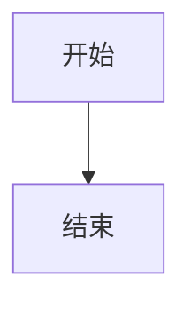
````

（上面这个「套子」的写法看一眼就好，用工具条按钮会自动插好。）

下面每种图都是两段：**先给你可以照抄的代码，后面紧跟着这张代码画出来的图**（在软件里直接可见）。

> 通用小规则：
> - `-->` 箭头，`---` 普通连线；
> - 文字里有括号、引号等符号时，用引号包起来最保险；
> - 缩进随意（对齐好看就行），大小写不敏感（`flowchart` 与 `Flowchart` 一样）；
> - 写错了不会弄坏任何东西——显示不出来时会原文展示，改对即恢复。

### 1. 流程图（flowchart）——最常用

描述「先做什么、再做什么、分支去哪」。

```text
flowchart TD
    A[打开软件] --> B{今天有卡要复习吗}
    B -->|有| C[去复习]
    B -->|没有| D[去书架读书]
    C --> E[诚实评分]
```

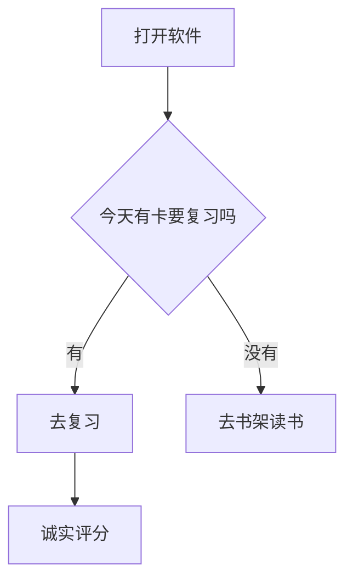

要点：`TD` 表示从上到下（Top-Down），改成 `LR` 就是从左到右；`A[文字]` 方框，`B{文字}` 菱形判断，`-->|文字|` 带标签箭头，`-.->` 虚线箭头。

### 2. 时序图（sequenceDiagram）——谁对谁说了什么

按时间顺序表示几方之间的来来回回。

```text
sequenceDiagram
    participant 我
    participant 软件
    我->>软件: 打开一本书
    软件-->>我: 显示正文
    我->>软件: 划选一段文字
    软件-->>我: 弹出摘录菜单
```

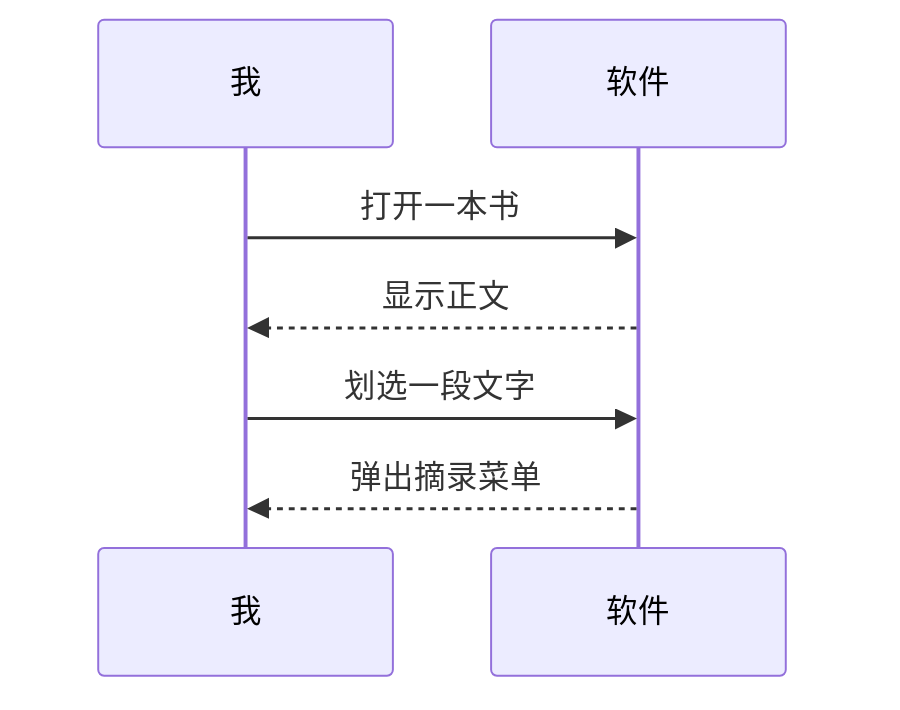

要点：`->>` 实线箭头，`-->>` 虚线箭头（常用于回应），冒号后是消息文字。

### 3. 类图（classDiagram）——有哪几类东西、什么关系

适合整理概念（比如「卡片分几种」）。

```text
classDiagram
    class Card {
        +String front
        +String back
        +review()
    }
    class ExtractCard
    class VocabCard
    Card <|-- ExtractCard
    Card <|-- VocabCard
```

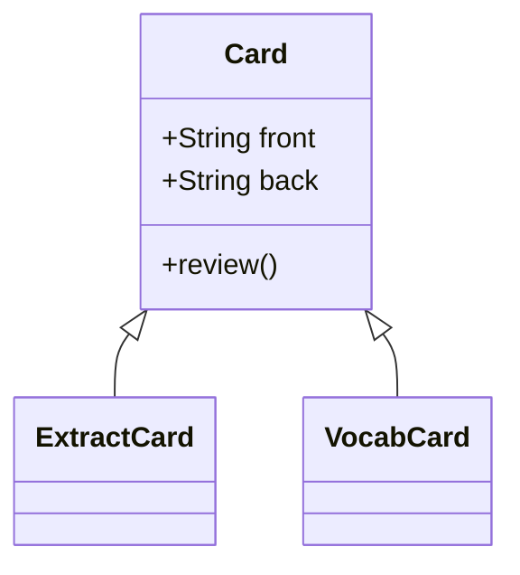

要点：`<|--` 表示「继承自」；花括号里列成员，`+` 公开 `-` 私有。

### 4. 状态图（stateDiagram-v2）——一件事的几种状态

描述一个东西会在哪几个状态之间切换。

```text
stateDiagram-v2
    [*] --> idle
    idle --> reading: 打开书
    reading --> reviewing: 开始复习
    reviewing --> reading: 继续读
    reading --> [*]: 读完
```

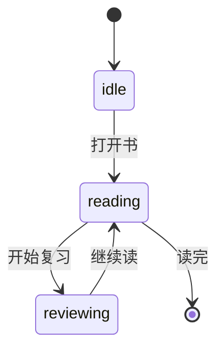

要点：`[*]` 是开始/结束圆点；`状态 --> 状态: 原因`。

### 5. 实体关系图（erDiagram）——数据库/事物之间怎么关联

```text
erDiagram
    book ||--o{ extract : 生成摘录
    extract ||--o{ card : 制成卡片
    book ||--o{ card : 拥有
```

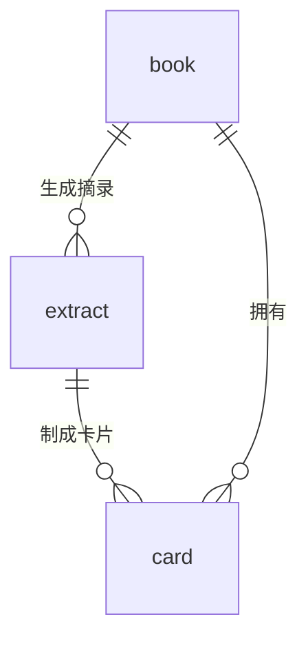

要点：`||--o{` 读作「一对多」；连线中间写关系名。

### 6. 用户旅程图（journey）——一件事的体验过程

```text
journey
    title 我的一天
    section 上午
      读书: 5: 我
      做摘录: 4: 我
    section 晚上
      复习卡片: 3: 我
```

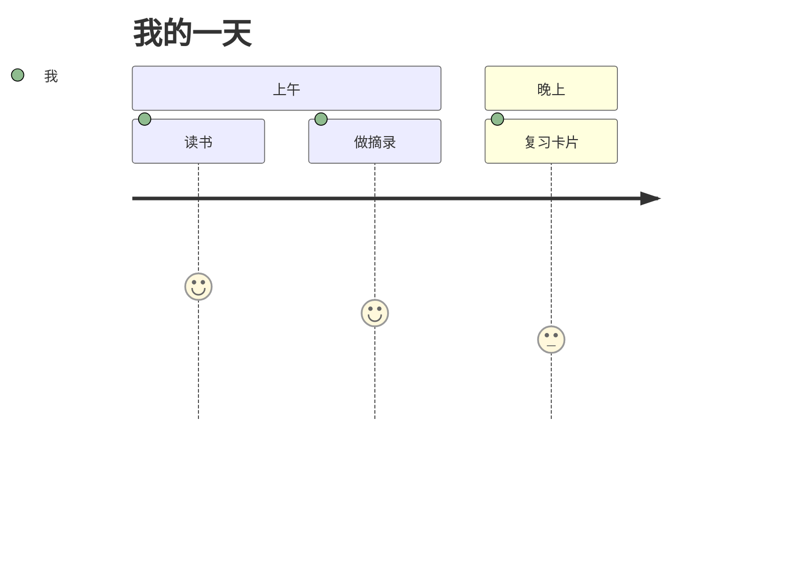

要点：`做某事: 分数(0-10): 参与者`，分数画在曲线高度上。

### 7. 甘特图（gantt）——排计划、看进度

```text
gantt
    title 学习计划
    dateFormat YYYY-MM-DD
    section 第一周
        读第一章 :a1, 2026-01-05, 3d
        复习卡片 :after a1, 2d
    section 第二周
        读第二章 :2026-01-12, 4d
```

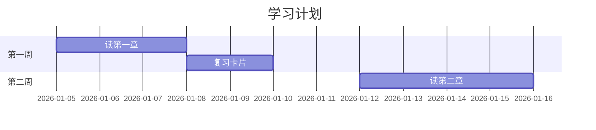

要点：`dateFormat` 固定写 `YYYY-MM-DD`；任务写法 `名字 :编号, 开始日, 持续`，`after 编号` 表示接着上一个任务。

### 8. 饼图（pie）——比例一望即知

```text
pie showData
    title 时间都去哪了
    "阅读" : 40
    "复习" : 35
    "制卡" : 25
```

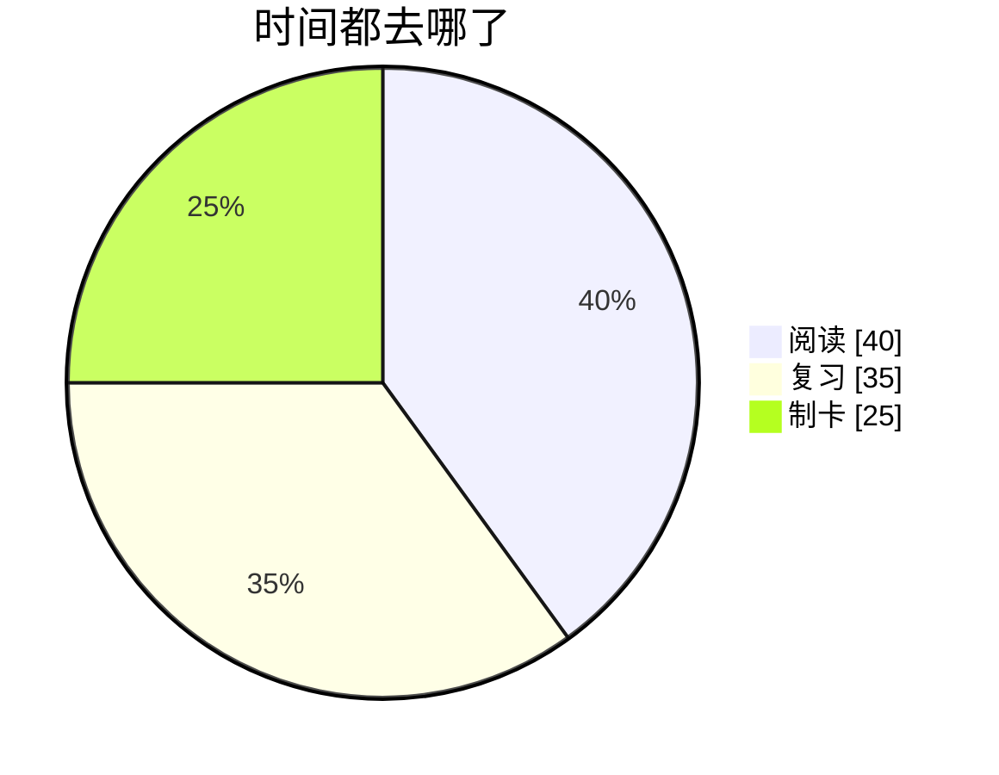

要点：`"名称" : 数值`；`showData` 表示把数值标在图上（可省略）。

### 9. 象限图（quadrantChart）——按两个维度归类

```text
quadrantChart
    title 怎么安排这些事
    x-axis 不紧急 --> 紧急
    y-axis 不重要 --> 重要
    quadrant-1 马上做
    quadrant-2 计划做
    quadrant-3 少做点
    quadrant-4 委托做
    写报告: [0.75, 0.8]
    回消息: [0.8, 0.3]
    学外语: [0.3, 0.85]
```

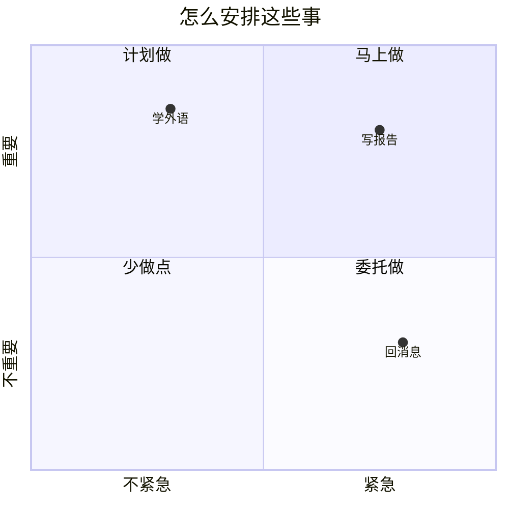

要点：点的位置 `[横向0-1, 纵向0-1]`，右上是第 1 象限。

### 10. 需求图（requirementDiagram）——需求与实现对应

```text
requirementDiagram
    requirement remember_words {
        id: 1
        text: "每天复习新学的单词"
        risk: high
        verifymethod: test
    }
    element daily_review {
        type: "日常任务"
    }
    daily_review - satisfies -> remember_words
```

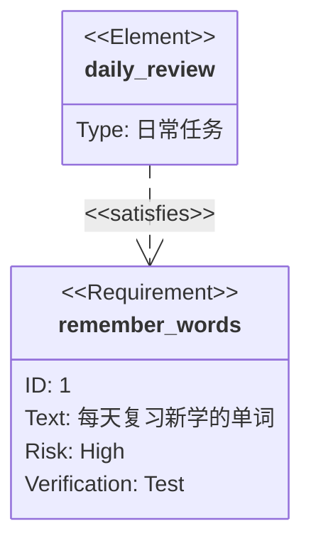

### 11. Git 图（gitGraph）——提交分支历史

```text
gitGraph
    commit id: "初版"
    branch dev
    commit id: "加复习功能"
    checkout main
    merge dev
    commit id: "发布"
```

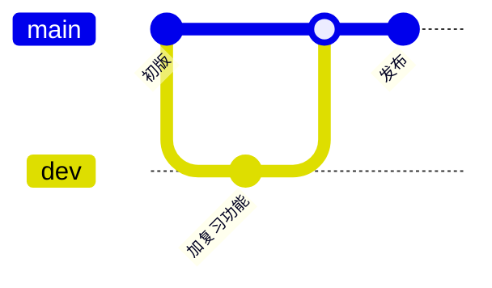

### 12. C4 架构图（C4Context）——系统与人的关系

```text
C4Context
    title 学习系统全貌
    Person(learner, "学习者", "想记住知识的人")
    System(app, "本软件", "渐进阅读学习工具")
    Rel(learner, app, "每天使用")
```

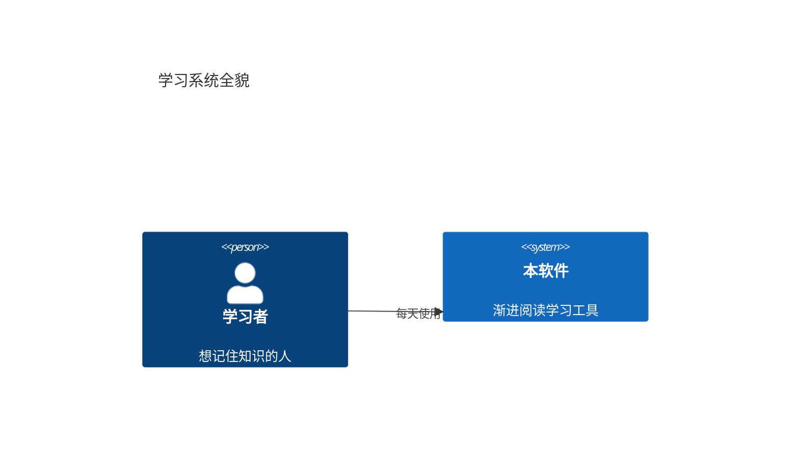

### 13. 思维导图（mindmap）——发散整理想法

```text
mindmap
  root((学习))
    输入
      读书
      看视频
    加工
      摘录
      制卡
    巩固
      复习
```

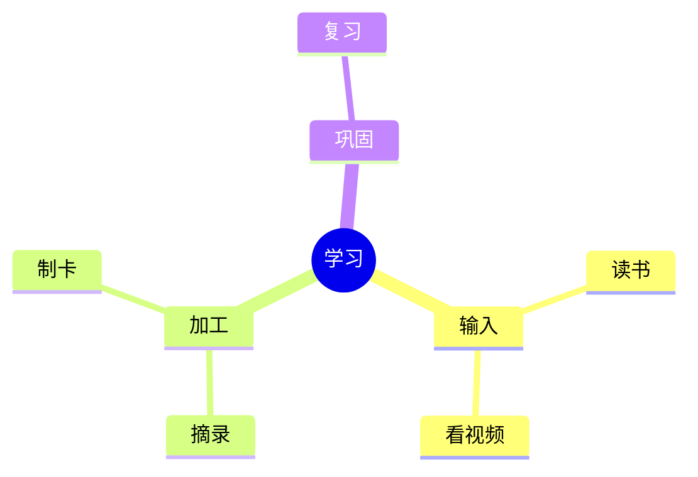

要点：靠**缩进**表示层级；`root((文字))` 圆形根节点。

### 14. 时间线（timeline）——大事记

```text
timeline
    title 一个下午
    14点 : 打开书架
    15点 : 读完一章
         : 做了三张卡
    16点 : 开始复习
```

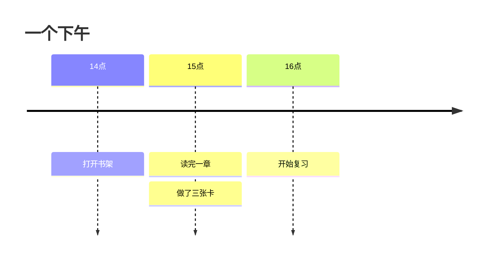

要点：同一时间点的多件事，后续行只写 `: 事情`。

### 15. 桑基图（sankey）——流量去向

```text
sankey
学习时间,读书,120
学习时间,查词,30
复习时间,复习卡片,90
复习时间,补漏,20
```

```mermaid
sankey
学习时间,读书,120
学习时间,查词,30
复习时间,复习卡片,90
复习时间,补漏,20
```

要点：每行 `来源,去向,数量`（英文逗号）。

### 16. 柱状/折线图（xychart）——数字趋势

```text
xychart
    title "每周复习量"
    x-axis ["一", "二", "三", "四", "五", "六", "日"]
    y-axis "卡片数" 0 --> 100
    bar [20, 35, 50, 40, 60, 75, 55]
    line [20, 35, 50, 40, 60, 75, 55]
```

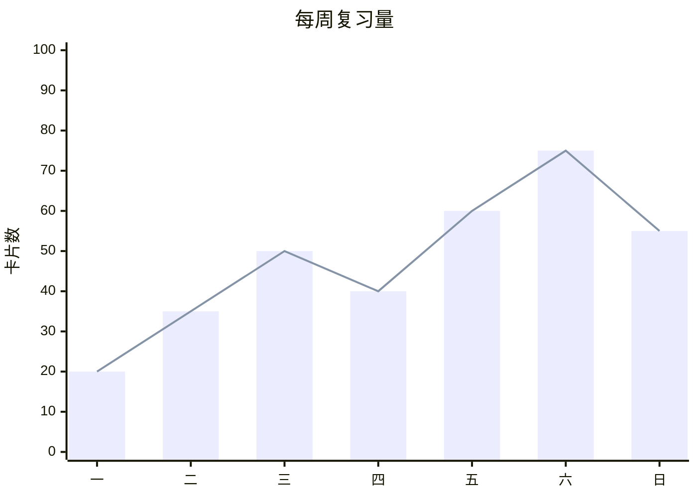

要点：`bar` 柱、`line` 线，可只用其一。

### 17. 方块图（block）——版块布局

```text
block
  columns 3
  r["读书"] :3
  e["摘录"]
  c["制卡"]
  v["复习"] :3
```

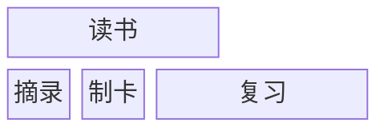

要点：`columns 3` 三列网格；`:3` 表示横跨 3 列。

### 18. 数据包图（packet）——二进制位段

```text
packet
0-15: "源端口"
16-31: "目标端口"
32-47: "包长度"
48-63: "校验和"
```

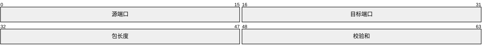

要点：每行 `起始位-结束位: "名称"`。

### 19. 看板（kanban）——任务分栏

```text
kanban
  todo[待办]
    t1[读第一章]
  doing[进行中]
    t2[制作闪卡]
  done[完成]
    t3[安装软件]
```

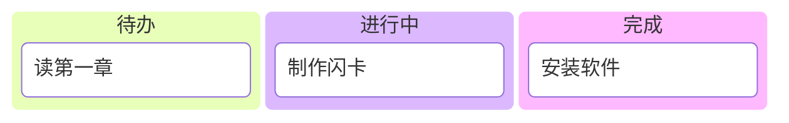

### 20. 架构图（architecture）——服务怎么连

```text
architecture-beta
    group learn(cloud)[学习系统]
    service reader(database)[阅读器] in learn
    service engine(server)[复习引擎] in learn
    reader:L -- R:engine
```

```mermaid
architecture-beta
    group learn(cloud)[学习系统]
    service reader(database)[阅读器] in learn
    service engine(server)[复习引擎] in learn
    reader:L -- R:engine
```

### 21. 雷达图（radar）——多维度对比

```text
radar-beta
  axis a["听力"], b["口语"], c["阅读"], d["写作"], e["词汇"], f["语法"]
  curve me["我"]{80, 65, 90, 70, 85, 75}
  max 100
  min 0
```

```mermaid
radar-beta
  axis a["听力"], b["口语"], c["阅读"], d["写作"], e["词汇"], f["语法"]
  curve me["我"]{80, 65, 90, 70, 85, 75}
  max 100
  min 0
```

### 22. 智能体流程（agentflow）——AI 工作流

```text
agentflow-beta TB
  flow tutor["学习助手"]
    ask["提问"]@{ shape: input }
    think["检索笔记"]@{ shape: task }
    answer["给出回答"]@{ shape: task }
    ok["满意？"]@{ shape: decision }
    ask --> think --> answer --> ok
  end
```

```mermaid
agentflow-beta TB
  flow tutor["学习助手"]
    ask["提问"]@{ shape: input }
    think["检索笔记"]@{ shape: task }
    answer["给出回答"]@{ shape: task }
    ok["满意？"]@{ shape: decision }
    ask --> think --> answer --> ok
  end
```

### 23. Cynefin 图——判断问题属于哪类

```text
cynefin-beta
  title 这个问题属于哪一类
  clear
    "重启就能解决"
  complicated
    "需要专家分析"
  complex
    "先实验再总结"
  chaotic
    "立刻救火"
  confusion
    "还没想清楚"
```

```mermaid
cynefin-beta
  title 这个问题属于哪一类
  clear
    "重启就能解决"
  complicated
    "需要专家分析"
  complex
    "先实验再总结"
  chaotic
    "立刻救火"
  confusion
    "还没想清楚"
```

### 24. 事件建模（eventmodeling）——界面→命令→事件

```text
eventmodeling
tf 01 ui CartUI
tf 02 cmd AddItem
tf 03 evt ItemAdded
```

```mermaid
eventmodeling
tf 01 ui CartUI
tf 02 cmd AddItem
tf 03 evt ItemAdded
```

### 25. 鱼骨图（ishikawa）——追查原因

```text
ishikawa-beta
    照片模糊
    相机
        对焦不准
        快门太慢
    手
        拿不稳
    环境
        光线太暗
```

```mermaid
ishikawa-beta
    照片模糊
    相机
        对焦不准
        快门太慢
    手
        拿不稳
    环境
        光线太暗
```

要点：第一行是「鱼头」（问题），后面每个大类是大骨，缩进的是小骨。

### 26. 信息卡（info）——显示图版本

```text
info
```

```mermaid
info
```

（它会画一张关于图表引擎本身的小卡片。）

### 27. 铁路图（railroad）——语法规则可视化

```text
railroad-ebnf-beta
title "数字的定义"
digit = "0" | "1" | "2" | "3" ;
```

```mermaid
railroad-ebnf-beta
title "数字的定义"
digit = "0" | "1" | "2" | "3" ;
```

### 28. 泳道图（swimlane）——按角色分道走流程

```text
swimlane-beta LR
  subgraph customer[顾客]
    pick[挑商品]
    pay[付款]
  end
  subgraph shop[商家]
    ship[发货]
  end
  pick --> pay
  pay --> ship
```

```mermaid
swimlane-beta LR
  subgraph customer[顾客]
    pick[挑商品]
    pay[付款]
  end
  subgraph shop[商家]
    ship[发货]
  end
  pick --> pay
  pay --> ship
```

### 29. 矩形树图（treemap）——按面积看占比

```text
treemap-beta
"学习时间"
    "读书": 60
    "查词": 10
"复习时间"
    "卡片": 30
```

```mermaid
treemap-beta
"学习时间"
    "读书": 60
    "查词": 10
"复习时间"
    "卡片": 30
```

### 30. 树视图（treeView）——目录树

```text
treeView-beta
├── 我的书架/
│   ├── 使用教程.md
│   └── 英语书.md
└── 我的卡片/
    └── 单词卡.md
```

```mermaid
treeView-beta
├── 我的书架/
│   ├── 使用教程.md
│   └── 英语书.md
└── 我的卡片/
    └── 单词卡.md
```

### 31. 用例图（usecase）——谁能用系统做什么

```text
usecase-beta
direction LR
actor Student("学生")
systemBoundary "学习系统"
  Read("阅读材料")
  Review("复习卡片")
end
Student --> Read
Student --> Review
```

```mermaid
usecase-beta
direction LR
actor Student("学生")
systemBoundary "学习系统"
  Read("阅读材料")
  Review("复习卡片")
end
Student --> Read
Student --> Review
```

### 32. 韦恩图（venn）——集合之交

```text
venn-beta
  title 什么是好产品
  set Useful
  set Usable
  set Beautiful
  union Useful,Usable["好用"]
  union Useful,Beautiful["有价值"]
  union Usable,Beautiful["好看"]
  union Useful,Usable,Beautiful["完美"]
```

```mermaid
venn-beta
  title 什么是好产品
  set Useful
  set Usable
  set Beautiful
  union Useful,Usable["好用"]
  union Useful,Beautiful["有价值"]
  union Usable,Beautiful["好看"]
  union Useful,Usable,Beautiful["完美"]
```

### 33. 沃德利地图（wardley）——战略演进图

```text
wardley-beta
title "奶茶店价值链"

anchor Customer [0.95, 0.63]
component tea [0.79, 0.61]
component leaf [0.63, 0.81]
component water [0.52, 0.80]
component kettle [0.43, 0.35]

Customer -> tea
tea -> leaf
tea -> water
water -> kettle

evolve kettle 0.62
```

```mermaid
wardley-beta
title "奶茶店价值链"

anchor Customer [0.95, 0.63]
component tea [0.79, 0.61]
component leaf [0.63, 0.81]
component water [0.52, 0.80]
component kettle [0.43, 0.35]

Customer -> tea
tea -> leaf
tea -> water
water -> kettle

evolve kettle 0.62
```

（这种图的名字建议用英文单词，坐标 `[横向, 纵向]` 都是 0 到 1，`evolve` 表示某组件正在向右演化。）

---

## 附录：常见问题

**图没有显示，显示成了代码？**
说明围栏写错了：第一行必须是三个反引号紧跟 `mermaid`（反引号要在行首）。最简单的办法是用工具条的图表按钮，自动插好。

**图里文字有特殊符号（括号、引号）出错？**
把节点文字用引号包起来：`A["带(括号)的文字"]`。

**在哪里试这些例子最方便？**
书架 → 添加材料 → 粘贴材料，把例子粘进去保存，立刻能看到渲染效果。

**这本教程可以删吗？**
可以，它就是一本普通材料，删除不影响任何功能。

祝学习愉快！记住核心节奏：**读一点，摘一点，做几张卡，诚实评分**——剩下的交给算法。
